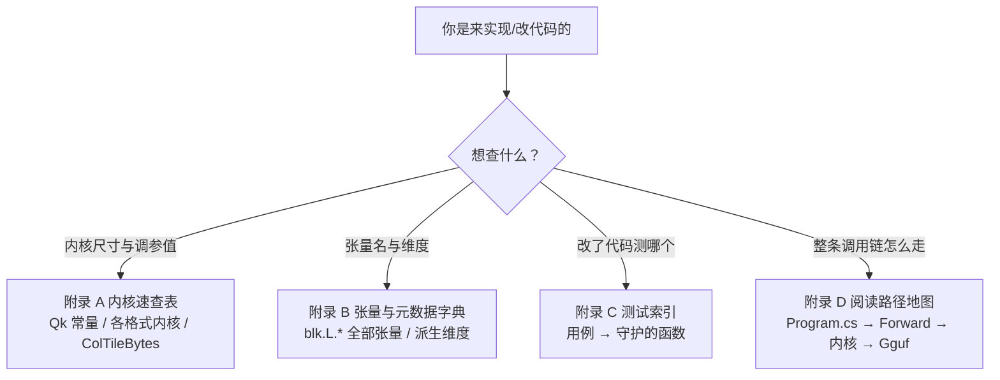

# 附录

> **读者导航（大白话）**：附录是"查字典"用的，不要求从头读到尾。当你动笔实现、或改了代码不知道撞到哪，就回来查。四个附录的用途：



> 附录是把正文里散落的"抄写件"集中收拢的参考章节。它们不是阅读正文的必需品，但当动笔实现或改动代码时，是不必重新翻 17 章的速查表——每个表项都附带真实代码位置。
>
> - 附录 A 内核速查表
> - 附录 B 张量与元数据字典
> - 附录 C 测试索引
> - 附录 D 阅读路径地图

---

## 附录 A 内核速查表

> 锚点源码：`src/Qwen35Sharp.Kernels/BlockLayout.cs`（`Qk`）、`GemmQ4K.Avx2.cs`（`ColTileBytes`）、`MulMatQ2.cs`（`ColTileBytes`）、`doc/04-quantization.md` §4.1、`doc/05-kernels.md`

### A.1 块尺寸常量（`Qk` 静态类）

```csharp
public static class Qk
{
    public const int SuperBlock = 256;      // K 系 super-block 值数
    public const int ScaleBytes = 12;       // Q4_K/Q5_K scales 字节数
    public const int Q4KSize = 144;         // Q4_K 块
    public const int Q8KSize = 292;         // Q8_K 块
    public const int Q4Kx8Size = 1152;      // 8 列 Q4_K panel
    public const int Q4Kx8MetaSize = 448;   // panel 预解码 meta
    public const int Q8Kx4Size = 1168;      // 4 行 Q8_K panel
    public const int Q5KSize = 176;
    public const int Q6KSize = 210;
    public const int IQ4XSSize = 136;
    public const int Q6Kx8Size = 2848;
    public const int Q2_0CSize = 130;       // 512 值
    public const int Q2x8Size = 1056;
    public const int STQ1_0BlockLength = 256;
    public const int STQ1_0Size = 42;
    public const int STQ1_0x8Size = 8 * sizeof(float) + 512;
}
```

### A.2 各格式内核一览

| 内核 | 用途 | 关键实现 |
|------|------|---------|
| `VecDotQ4K.Dot` | decode 单行 Q4_K × Q8_K | `DotAvx2`：`vpmaddubsw` + SSE 低位槽累积 accMin；`DotScalar` 标量参考 |
| `Q6K.Dot`/`DotScalar`/`DotAvx2` | decode Q6_K | m3/m12/m48/mC0 掩码提升 6-bit；`DotAvx2x4` 一解多用（4 行） |
| `Q2_0C.Dot`/`DotAvx2` | decode Q2_0C | `Dot256` 字节→dword→独立字节，无临时权重存储 |
| `IQ4XS.Dot` | decode IQ4_XS | 查 `kvalues_iq4nl` 表，免展开 |
| `STQ1_0.DotAvx2`/`DotScalar` | decode STQ | `vpshufb` 码本 + `SignMaskLut`（DotChunk16） |
| `GemmQ4K.Gemm8x8` | prefill 4×8 Q4_K | `GemmAvx2` 无 shuffle 端口；`ColTileBytes=128*1024` |
| `GemmQ6K.Gemm8x8` | prefill 4×8 Q6_K | u8 展开 + `ShiftLeftLogical(c,5)` −32 修正 |
| `Q2Panel.Gemv`/`Gemm` | Q2 panel | `ColumnOrder` 列序修正 |
| `STQPanel.Gemv`/`Gemm` | STQ panel | 同上 |
| `MulMatQ4K` | Q4_K 调度 + 尾部补算 | `tokens==1` → GEMV；`PackedGroups(nOut)=nOut/8` |
| `MulMatPanel.QuantizeAndGemm` | 共享量化 + 三连 GEMM | `PanelWeight` + `pool.Barrier()` |

### A.3 调参值

```csharp
public static int ColTileBytes = 128 * 1024;          // GemmQ4K.Avx2.cs
public static int ColTileBytes = 64 * 1024;           // MulMatQ2.cs
// KV 缓存起点：Math.Min(ContextLength, 4096)，倍增扩容（EnsureCache）
// scratch 余量：4 MB（EnsureScratch）
```

---

## 附录 B 张量与元数据字典

> 锚点源码：`src/Qwen35Sharp.Model/ModelConfig.cs`（`FromGguf`）、`Qwen35Model.cs`（`LoadWeights`）、`doc/03-gguf.md`、`doc/06-model.md`

### B.1 层结构速查（所有层通用）

```
hidden → attn_norm（zero-centered RMSNorm）
       → token 混合器（全注意力 或 Gated-DeltaNet）→ 残差
       → post_attention_norm（zero-centered RMSNorm）→ FFN → 残差
```

### B.2 全注意力层张量（`blk.L.*`，`IsRecurrent == false`）

| 张量 | 形状 | 用途 |
|------|------|------|
| `attn_norm.weight` | hidden | 层输入 RMSNorm |
| `attn_q.weight` | hidden → 2·qDim | 查询 + 门控（2 倍宽，头内交错） |
| `attn_k.weight` | hidden → kvDim | 键（GQA） |
| `attn_v.weight` | hidden → kvDim | 值 |
| `attn_q_norm.weight`/`attn_k_norm.weight` | headDim | per-head RMSNorm |
| `attn_output.weight` | qDim → hidden | 输出投影 |
| `post_attention_norm.weight` | hidden | 残差后 norm |
| `ffn_gate/up/down.weight` | hidden ↔ ffn | SiLU-MLP 三段 |

### B.3 Gated-DeltaNet 层张量（`blk.L.*`，`IsRecurrent == true`）

| 张量 | 形状 | 用途 |
|------|------|------|
| `attn_qkv.weight` | hidden → convDim | 拼接 q/k/v |
| `attn_gate.weight` | hidden → valueDim | 门控 z |
| `ssm_conv1d.weight` | [kernel][convDim] | 因果深度卷积核 |
| `ssm_beta.weight` | hidden → heads | β |
| `ssm_alpha.weight` | hidden → heads | α |
| `ssm_a`（F32） | heads | log A，**已烘烤成 −exp(A)** |
| `ssm_dt.bias`（F32） | heads | dt 偏置 |
| `ssm_norm.weight` | valueDim | 门控 RMSNorm |
| `ssm_out.weight` | valueDim → hidden | 输出投影 |

### B.4 MoE 张量（`blk.L.*`，arch `qwen35moe`）

| 张量 | 形状 | 用途 |
|------|------|------|
| `ffn_gate_inp.weight` | hidden → experts（F32） | router |
| `ffn_gate_exps.weight`/`up_exps` | hidden → moeFfn → experts（3D） | 专家 gate/up |
| `ffn_down_exps.weight` | moeFfn → hidden → experts（3D） | 专家 down |
| `ffn_gate_inp_shexp.weight` | hidden → 1（F32） | 共享门控 logit |
| `ffn_gate_shexp`/`up_shexp`/`down_shexp` | hidden ↔ sharedFfn | 共享专家 |

### B.5 派生维度（`ModelConfig`）

```csharp
LinearConvDim  = 2*SsmGroupCount*SsmStateSize + SsmInnerSize
LinearKeyDim   =   SsmGroupCount*SsmStateSize
LinearValueDim =   SsmTimeStepRank*SsmStateSize
FullQDim       = NumHeads*HeadDim
FullKvDim      = NumKvHeads*HeadDim
```

### B.6 层类型判定（`ModelConfig.FromGguf`）

```
blk.L.attn_qkv.weight 存在 → 线性注意力层
blk.L.attn_q.weight   存在 → 全注意力层
都没有                   → 回退公式 (L+1) % full_attention_interval != 0
整个文件都没有层张量      → 全部用公式
```

---

## 附录 C 测试索引

> 锚点源码：`tests/Qwen35Sharp.Tests/`、`doc/10-testing.md`

| 测试类 | 用例 | 守护的代码 | 容差/断言 |
|--------|------|-----------|----------|
| `FastExpTests` | `ExpAvx2_TracksMathF` / `SiLUMul_TracksScalar` | `FastExp.ExpAvx2`/`Ops.SiLUMulRange` | < 2e-5 / < 2e-4 |
| `FastExpTests` | `Quantize4x8Silu_MatchesSiLUThenQuantize` | `QuantizeQ8Kx4.Quantize4x8Silu` | 逐字节一致 |
| `FastExpTests` | `ThreadPool_ForSplitsWork` | `CpuThreadPool.For` | [0,32) 每项一次 |
| `GatedDeltaNetOpsTests` | `RecurrentGatedDeltaRule_MatchesReference` | `RecurrentGatedDeltaRule`/`DeltaStep` | < 1e-3（含状态 S） |
| `GgufTypeTests` | `LegacyStride16Type42IsNormalizedWithoutBreakingQ2` | `CanonicalTensorType` | STQ1_0 / Q2_0 各测 |
| `IQ4XSTests` | `DequantizeRow_MatchesReference` / `Dot_MatchesScalarDequant` | `IQ4XS.DequantizeRow`/`Dot` | < 1e-4 / 1e-2·1e-4 |
| `KvCacheAlignTests` | `DivergingTail_KeepsSharedPrefix` 等 5 例 | `KvCacheAlign.Plan` | 行为断言 |

> 已知盲区（doc/10-testing.md §10.4）：无端到端生成测试；MoE/STQ/Q2/Q5/Q6 的 panel 与 GEMV 尚无专项对拍；BPE 与聊天模板无专项单测。

---

## 附录 D 阅读路径地图

> 一条"代码徒步"路线：用户敲下命令到 logits 落地，把 17 章的锚点穿成一条可走的链，随真实调用链标注文件。

```
用户输入
  ▼
src/Qwen35Sharp.Cli/Program.cs
  ├─ Args.Get / Args.GetInt                            （第 14 章）
  ├─ Reply(model, messages, user, maxTokens)
  ├─ ChatTemplate.RenderQwen35(messages)                （第 13 章）
  ├─ model.Tokenizer.Encode(rendered)                   （第 13 章，BpeTokenizer.Encode）
  ├─ model.AlignPrompt(promptIds)                       （第 10 章，KvCacheAlign + TruncateCache）
  ├─ model.Forward(align.Suffix)                        （第 9 章）
  ├─ ArgMax(logits) → 循环                                （第 14 章）
  ├─ model.Forward([token])                             （第 9 章，seq==1 → DecodeBlock）
  └─ WriteDelta(...)                                    （第 14 章）
        ▼
src/Qwen35Sharp.Model/Qwen35Model.cs
  ├─ Forward(int[] tokens)                              （第 9.1 节）
  │    ├─ EnsureCache / EnsureScratch / Bump            （第 8.4 节）
  │    ├─ Embed(tokens, h)                              （第 9.2 节）
  │    ├─ seq==1 ? DecodeBlock : PrefillBlock           （第 9.4 节）
  │    │     ├─ Rms(attn_norm)                          （Qwen35Ops.RmsNormZeroCentered，第 2/9 节）
  │    │     ├─ Decode/PrefillAttention                 （第 10 章：解交错/RoPE/评分/softmax/combine/门控）
  │    │     ├─ Decode/PrefillLinearAttn                （第 11 章：卷积/β、α/递推/门控 RMSNorm/输出）
  │    │     └─ FFN：DecodeGateUp/SiluQuantizeAndGemm   （第 9/6 章）或 SparseMoe（第 12 章）
  │    └─ Rms(output_norm) + Linear("output.weight", fallback="token_embd.weight")
  ├─ AlignPrompt（KvCacheAlign.Plan，第 10.5 节）
  ├─ TruncateCache / ResetCache                         （第 10.5/14.3 节）
  └─ Ticks* / ResetProfile                              （第 16.1 节）
        ▼
src/Qwen35Sharp.Kernels/
  ├─ Q8K.QuantizeRow / ScaleBlock                       （第 5.2 节）
  ├─ VecDotQ4K / Q6K / Q2_0C / IQ4XS / STQ1_0 / Q5K     （第 5.3–5.4 节）
  ├─ MulMat*：tokens==1 → GEMV，否则 → panel GEMM       （第 6.6 节）
  ├─ QuantizeQ8Kx4.Quantize4x8 / Quantize4x8Silu        （第 6.3 节）
  ├─ GemmQ4K / GemmQ6K / Q2Panel / STQPanel             （第 6.4 节）
  ├─ MulMatPanel.QuantizeAndGemm / SiluQuantizeAndGemm  （第 6.5 节）
  ├─ FastExp.ExpAvx2 / SiluAvx2                         （第 5.5 节）
  ├─ CpuThreadPool.For / Barrier                        （第 7.2 节）
  └─ CpuTopology / NativeBuffer / ScratchArena          （第 7.1/7.3 节）
        ▼
src/Qwen35Sharp.Gguf/
  ├─ GgufFile：Parse / Get* / Coerce* / CanonicalTensorType（第 3.2–3.6 节）
  ├─ GgufTensorInfo / GgmlTensorType                     （第 3.5 节）
  └─ 内存映射（MemoryMappedFile + AcquirePointer）        （第 3.3 节）
```

**徒步守则**：改一个算子，先找它所在的静态类 + 对应 `Ticks*` 计数器 + 参考对拍测试，三位一体地改；改格式，先 `BlockLayout.cs` 的 `Qk` 常量与 block struct，再重打包器，再 `MulMat*` 新分支，最后格式测试。任何改动跑一遍 `dotnet test tests/Qwen35Sharp.Tests/Qwen35Sharp.Tests.csproj`——附录 C 的索引告诉你哪些测试在守门。