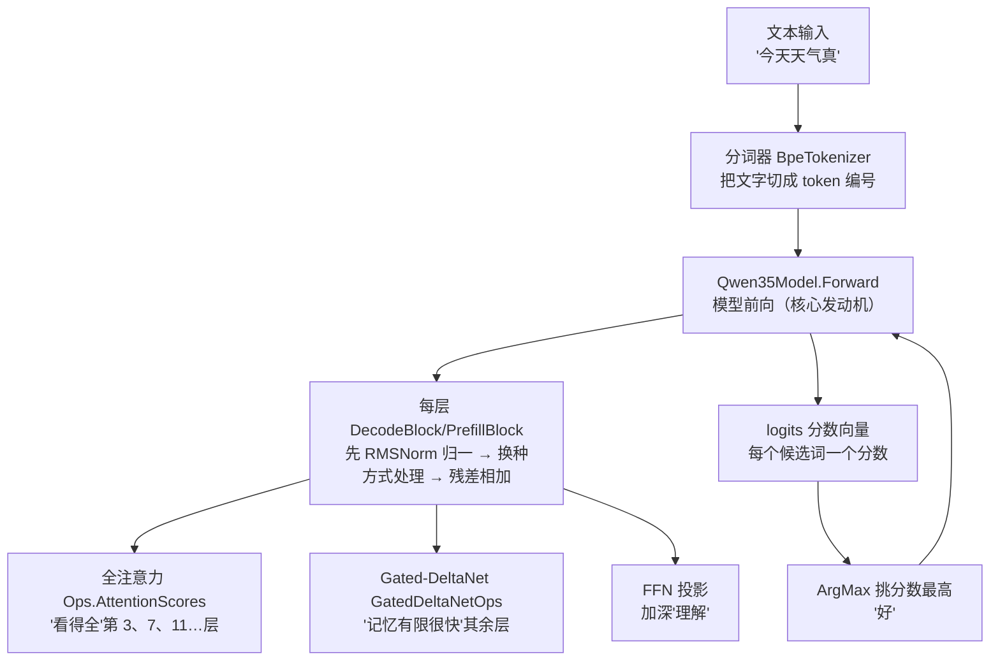
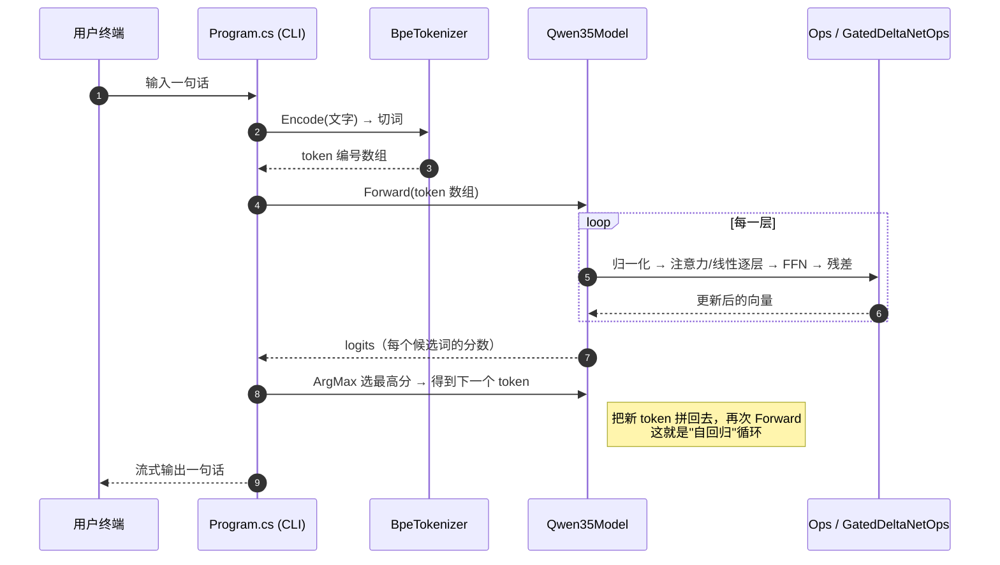

# 第 1 章 缘起：为什么要用 C# 从零写一个推理引擎

> 面向初学者：这一章不要求任何编程或机器学习背景，只管弄明白"我们要造一个什么东西"。
> 每个概念都用大白话讲，关键结构配 mermaid 图，并贴出项目源码里的**真实代码**。

这一章不出现推理实现。它是整本书的"开工会议"：搞清楚**我们要做什么、不动什么、用什么工具、走哪条路**。

## 1.1 目标与边界：这个引擎"从零"到什么程度

先回答一个很直接的问题：**网上有现成的 llama.cpp 能跑模型，为什么还要自己写一遍？**

打个比方：有人能开车，有人会修发动机。llama.cpp 是"一辆设计精良的成品车"，而这本书教你的是"把发动机拆开、搞清楚每一颗螺丝为什么在那儿、再用自己的零件重新装一台"。我们不追求造出更好的车，我们追求的是**彻底理解车为什么能跑**。

"从零"在这里具体指放弃三样东西：

- **不用深度学习框架**：PyTorch 会把"模型"包装成一个对象，调用一下就完事。我们不要这层包装——权重就是内存里的一排数字，我们要自己读懂它们。
- **不用 GPU 和加速库**：不碰 CUDA、不碰 cuBLAS。所有计算用 CPU 上的手写向量指令（AVX2 等）完成，这样你随时能看清每一步在算什么。
- **不抄 llama.cpp 的代码**：我们参考它公布的公式和文件格式（这叫"规格说明书"），但每一行代码都自己写。

同时把**不做什么**也划清楚，否则这本书会失控：

- 不做图片/视频理解（视觉多模态）；
- 不做"predict 多个候选"（投机解码）；
- 命令行只做"挑概率最高的那个词"（贪心），暂不做花哨的采样。

因此，全书的"小目标"只有一句话：**加载一个模型文件 → 让它生成一段话 → 结果和主流工具一致**。三件事，缺一不可。这本书的每一章，都在为这三件事的某一环服务。

## 1.2 本书的主角：一个混合 Transformer——Qwen3.5

大白话先来一遍：大语言模型（LLM）的本质，是**一个会"接着往下写"的程序**。你给它"今天天气真"，它能接"好"。它"懂"的一切，都来自一段长文本里词和词之间的搭配规律。

Qwen3.5 是一个"混合"模型，意思是它体内有两种不同的"文字处理器"轮流工作。用最朴素的话描述：

> 处理一句话时，前一段时间用"A 方式"（线性注意力：记忆有限，速度快），隔一阵用一次"B 方式"（全注意力：记忆完整，看得全），两种方式交替着把整句话看完。

两种方式的具体区别后面会讲透，这里只要记住一个调度规律：**每 4 层里，第 4 层用"B 方式"（全注意力），其余 3 层用"A 方式"（线性注意力）**。项目里管这个规律的配置叫 `full_attention_interval = 4`。

实现时怎么判断"这一层到底是 A 还是 B"？项目有个很聪明的做法——**看权重的名字，不猜**。后面第 8 章会给出真实代码。现在先用一张图把整本书的主干画出来：



这张图就是整本书的"总路线图"：文字进来 → 切成编号 → 一层层"处理+残差" → 得出每个词的分数 → 挑最高的 → 拼回去继续。后面每一章都是在把图中的某一个方块做出来。

## 1.3 技术选型与工程骨架：我们要住在哪条街上

### 为什么选 C# / .NET 10

选语言这事，很像选工具箱——要选"能让新手看清零件、又能让行家拧紧螺丝"的那套。C# 恰好两头兼顾：

- **难的地方手动，简单的地方自动**：需要精确控制内存的地方（比如按字节读权重），C# 允许你写 unsafe 指针；其余 90% 的地方，垃圾回收器（GC）帮你管内存，不用像 C/C++ 那样心惊胆战。
- **自带"向量指令"接口**：CPU 有专门的"一次算 8 个浮点数"的指令，C# 的 `System.Runtime.Intrinsics.X86` 直接能调用，不用装任何第三方库。
- **能完美还原字节布局**：模型的权重文件是二进制字节，C# 用 `[StructLayout(Pack=1)]` 能精确地把一块内存"解读"成结构体，跟 C 语言一模一样。

全项目的公共配置写在根目录 `Directory.Build.props` 里，大致内容是这样（加注释版）：

```csharp
<!-- Directory.Build.props：所有子项目都继承这份配置 -->
<PropertyGroup>
  <TargetFramework>net10.0</TargetFramework>    <!-- 用 .NET 10 这个新版本 -->
  <AllowUnsafeBlocks>true</AllowUnsafeBlocks>  <!-- 允许写指针（读权重字节要用） -->
  <InvariantGlobalization>true</InvariantGlobalization> <!-- 不管在哪个国家，数字格式都一样 -->
  <Nullable>enable</Nullable>                  <!-- 强制标记"可能为空的变量"，少出空引用 bug -->
  <RootNamespace>Flygon</RootNamespace>        <!-- 所有类都放在 Flygon 命名空间下 -->
</PropertyGroup>
```

### 五层骨架，单向依赖

我们把整个程序拆成 5 层，每层只管自己的事，**上层能调用下层，下层绝不知道上层的存在**（这种设计叫"单向依赖"，好处是改一层不会牵一发而动全身）：

```mermaid
graph BT
    subgraph 最上层：命令行
        CLI["Qwen35Sharp.Cli<br/>src/Qwen35Sharp.Cli/Program.cs<br/>参数解析 / 对话循环 / 打印输出"]
    end
    subgraph 中间：模型
        Model["Qwen35Sharp.Model<br/>src/Qwen35Sharp.Model/*<br/>模型本体：配置、前向、分词器"]
    end
    subgraph 底层：工具库
        Kernels["Qwen35Sharp.Kernels<br/>计算内核：GEMM/GEMV/线程池"]
        Gguf["Qwen35Sharp.Gguf<br/>文件读取：GGUF 解析器"]
    end
    CLI --> Model
    Model --> Kernels
    Model --> Gguf
```

翻译成大白话：命令行只负责"跟用户打交道"（收参数、打印结果），模型层负责"大脑"（前向计算、缓存、分词），内核层是"肌肉"（各种高效的乘法运算），GGUF 层是"嘴巴"（负责把磁盘上的模型文件读进内存）。

读者留意到项目源码第一行通常是 `namespace Flygon.Gguf;` 这种，这就是各层之间的"门牌号"。比如 `src/Qwen35Sharp.Gguf/GgufFile.cs` 开头：

```csharp
namespace Flygon.Gguf;                          // 属于 GGUF 文件读取这一层

/// <summary>
/// Memory-maps a GGUF v2/v3 file. Metadata is parsed immediately; tensor
/// payloads stay in the map and are addressed as DataBase + Offset.
/// </summary>
public sealed unsafe class GgufFile : IDisposable   // 核心读取器，负责打开模型文件
{
    private const uint Magic = 0x46554747;          // "GGUF" 四个字母的十六进制写法
    private const uint DefaultAlignment = 32;       // 默认对齐 = 32 字节
    // ... 其余字段与方法后面章节会一一展开 ...
}
```

这段代码现在看不懂没关系，重点是认识两件事：**第一行是门牌号（命名空间）**，**`GgufFile` 这个类是"读模型文件"的入口**。

## 1.4 主线：从字节到对话，一次完整的旅途

我们已经看过总路线图。这里更细致地把"一次回答"的完整流程标上对应的源码文件和章节，方便你随时回来查：



顺着这条主线，能看到贯穿全书的**四个回合**，后面每一章都为其中一个回合"上发条"：

1. **文件回合**（第 3、4 章）：`GgufFile` 读文件、`BlockLayout` 认字节。这是"读"。
2. **计算回合**（第 5、6、7 章）：`VecDotQ4K`/`GemmQ4K`/`CpuThreadPool` 让乘法飞快。这是"算"。
3. **模型回合**（第 8–12 章）：`ModelConfig` → `Qwen35Model` 搭出分层前向。这是"组织"。
4. **用户回合**（第 13、14 章）：`BpeTokenizer`/`ChatTemplate`/`Program` 让文字进得去出得来。这是"对话"。

四圈走完，你在终端敲一句话，引擎会流式回你一句——那时你会清楚地知道，从开头到那里你亲手放进了多少块砖。

**这一章还欠读者一个收尾问题**：推理引擎的源头，是磁盘上那个几个 GB 的 `.gguf` 文件——它把几千亿个数字压缩存放，还能让程序飞速找到其中任意一个。它到底长什么样？下一章我们先读懂模型的结构，第 3 章再把它装进来。