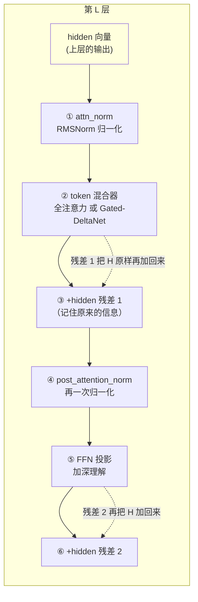
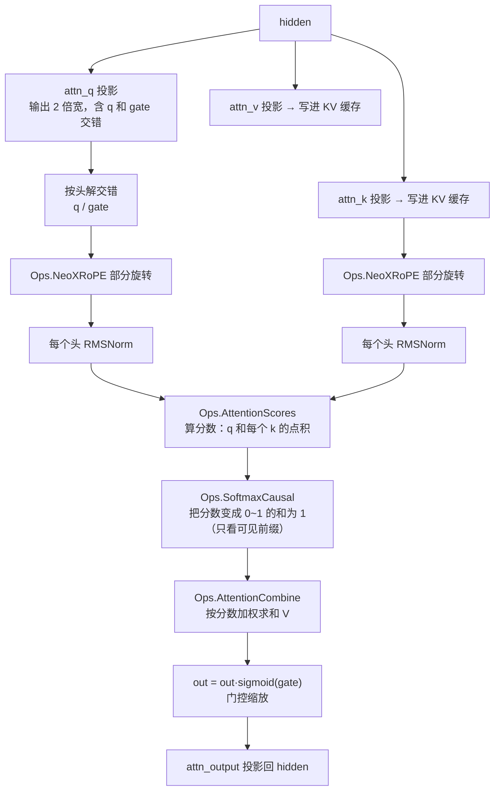
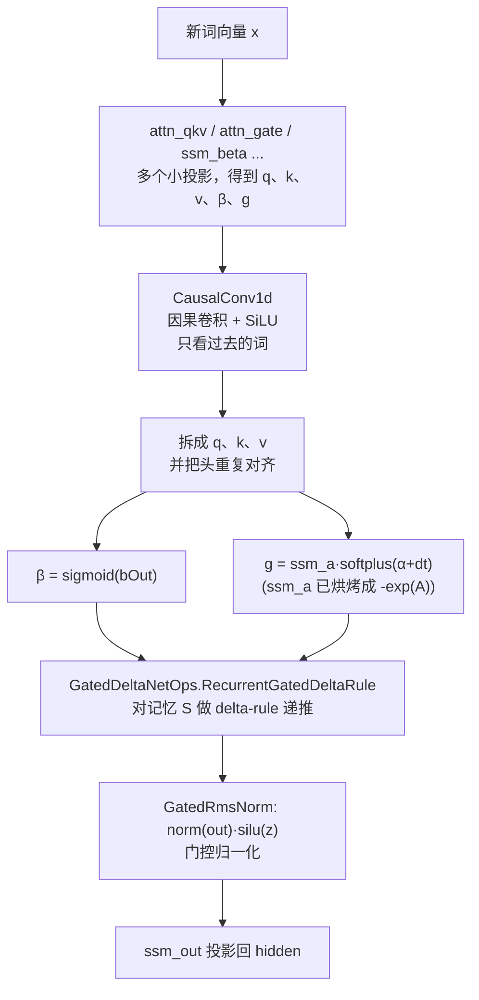

# 第 2 章 认识你的目标：Qwen3.5 的数学结构

> 面向初学者：本章不需要公式功底，只要求你愿意跟着"比喻 + 图 + 真实代码"把模型拆开。每小节都会贴出 `src/Qwen35Sharp.Model/` 里的**真实源码**，关键概念配 mermaid 图。

在写任何代码之前，我们必须先"看清"这个模型长什么样。这一章的走法是：我们**首先**立起"统一的一层"骨架（残差、RMSNorm、FFN，2.1 节）；**其次**看每四层一次的全注意力层（2.2 节）；**接着**看其余三层的 Gated-DeltaNet 线性注意力（2.3 节）；**然后**学会读 GGUF 张量名这本"注册表"（2.4 节）；**最后**把这一章的收获收拢成一句话。这一章是"认路"——每个公式后面都跟着它在源码里的真实形态。

## 2.1 统一的一层：残差、RMSNorm 与 FFN

先立骨架：**Qwen3.5 是由很多"一模一样的一层"叠起来的**，每一层处理完再把结果传给下一层。就像一座大厦由许多层楼组成，每层楼的结构相同，只是里面住的"内容"不同。



这张图有一个关键点你可能注意到了：`③ ` 和 `⑥ ` 都在做"把原来的输入再加回来"——这叫**残差连接**（residual）。为什么需要它？因为层数多了以后，信息经过几十层会"稀释"。残差就像给每层装了个"记忆书包"：无论这层处理成什么样，原始的 `hidden` 都会原样带上，保证信息不丢失。

**RMSNorm 的 Qwen 变体**是最容易踩的第一个坑。普通归一化（Llama 风格）是 `y = x·rsqrt(mean(x²)+eps)·w`，而 Qwen 系呢，权重初始化成 0，所以公式多了一个 `1+`：

```
y = x · rsqrt(mean(x²) + eps) · (1 + w)
```

别被 `rsqrt` 吓到——它就是 `1/√(...)`。两句大白话：**①先算每个数字的平方的平均，开根号取倒数，得到一个"尺度"；②让每个数除以这个尺度，保证一整行的数字"量级差不多"**。多出的 `(1+w)` 只是 Qwen 自己的口味。

`src/Qwen35Sharp.Model/Qwen35Ops.cs` 里的真实实现（带注释版）：

```csharp
/// <summary>
/// Zero-centered RMSNorm (Qwen3/Qwen3.5):
///   y = x * rsqrt(mean(x^2) + eps) * (1 + w)
/// 和常见的 Llama 版本不同：Qwen3.5 把权重 w 初始化为 0，
/// 所以这里乘的是 (1 + w)，不是 w。
/// </summary>
public static void RmsNormZeroCentered(float* x, float* weight, float* y,
    int rows, int dim, float eps, CpuThreadPool? pool = null)
{
    // 要不要并行？rows 很大（很多行）就交给线程池，否则单线程串行。
    if (pool == null || rows <= 1)
    {
        RmsNormZeroCenteredRange(x, weight, y, 0, rows, dim, eps);
        return;
    }
    pool.For(rows, (worker, workers) =>
    {
        int begin = rows * worker / workers;   // 第 worker 个线程负责的行范围 [begin, end)
        int end = rows * (worker + 1) / workers;
        RmsNormZeroCenteredRange(x, weight, y, begin, end, dim, eps);
    });
}
```

其中逐行的核心循环 `RmsNormZeroCenteredRange`（同文件）：

```csharp
private static void RmsNormZeroCenteredRange(float* x, float* weight, float* y,
    int begin, int end, int dim, float eps)
{
    for (int r = begin; r < end; r++)            // 对每一行
    {
        float* src = x + (long)r * dim;          // 这行数据的起点
        float* dst = y + (long)r * dim;          // 这行数据的落点（结果写这里）
        float sum = 0; int i = 0;
        if (Avx.IsSupported)                     // 如果 CPU 支持 SIMD（一次算 8 个数）
        {
            Vector256<float> acc = Vector256<float>.Zero;
            for (; i <= dim - 8; i += 8)         // 每 8 个数一组，算 x*x 的累加
            {
                Vector256<float> v = Avx.LoadVector256(src + i);
                acc = Fma.IsSupported ? Fma.MultiplyAdd(v, v, acc)   // acc += v*v
                                      : Avx.Add(acc, Avx.Multiply(v, v));
            }
            sum = VecDotQ4K.HorizontalSum(acc);  // 把 8 个累加槽"合"成一个数
        }
        for (; i < dim; i++) sum += src[i] * src[i];   // 剩余的部分逐个加
        float scale = 1f / MathF.Sqrt(sum / dim + eps);  // 求"尺度"：1/√(均值+ε)
        for (i = 0; i < dim; i++)
        {
            float w = weight != null ? weight[i] : 0f;
            dst[i] = src[i] * scale * (1f + w);   // 每个数都乘尺度、(1+w)
        }
    }
}
```

同一文件还有个 Gated 变体 `GatedRmsNorm`——`norm(x)·silu(gate)`，是输出门控专用（第 11 章的主角之一）。

**FFN 三段式**对应三个投影：`ffn_gate`/`ffn_up`/`ffn_down`。大白话：FFN 是"让模型把当前信息再深入加工一番"的小网络。它的两个投影 `gate` 和 `up` 共享同一份输入激大——这为第 5 章"一次量化、处处复用"埋下伏笔。

## 2.2 每四层一次的全注意力层

`full_attention_interval = 4`：第 3、7、11、15……层是全注意力。这个"全注意力"就是 Transformer 论文里最经典的那个：**让每个词都能"看"到句子里所有其他词**。比如"小狗追猫，它跑得快"，"它"指的是谁？全注意力会让"它"参考整句话，从而保持上下文连贯。

Qwen3.5 给全注意力加了三个"口味改动"（都在 `src/Qwen35Sharp.Model/Qwen35Model.Prefill.cs` 的 `PrefillAttention` 和 `Decode.cs` 的 `DecodeAttention` 里落地）：

- **改动一：查询投影多输出一倍**。`attn_q.weight` 输出 `2·qDim` 宽，多出的那一半作为"门控"（gate）。用途：算完注意力后，再"按元素"决定哪些位置的消息可信：

```
out = attention_output ⊙ sigmoid(gate)
```

- **改动二：Q/K 在打分前先做 per-head 归一化**。每个头单独做 RMSNorm，稳定分数。
- **改动三：部分 RoPE**。`RopeDim` 只旋转每个头的前 `RopeDim` 维。RoPE 大白话：给每个词的向量"加一段位置信息"，让模型知道这个词在第几个位置。部分旋转意思是只在部分维度上加位置信息，其余维度保留纯语义。

完整流程一张图（每步标注真实函数）：



## 2.3 其余三层：Gated-DeltaNet 线性注意力

全注意力的缺点是：每处理一个词，都要把前面所有词再看一遍，句子越长越慢、占内存越多。Qwen3.5 的巧妙之处是：**大部分层用一个"记性好但记不多"的方式**——`Gated-DeltaNet`（也叫 gated SSM，线性注意力）。

大白话：它随身带一个固定大小的小本子 `S`（记忆），每读一个词就"更新小本子"，新词来时从小本子里查"过去相关的信息"。小本子永远这么大，不管句子多长都不变。



它"读—改—写"记忆矩阵 S 的四步，会在第 11 章用真实代码逐行走一遍。这里先记住三个关键坑（避免以后踩雷）：

1. **`ssm_a` 已烘烤成 `−exp(A)`**——直接是衰减因子，别再取指数。
2. **L2 归一化恒开**——`l2normQk` 参数总传 true。
3. **它没有 KV 缓存**——代替它的是一个固定状态矩阵 + 一个小卷积窗口。

## 2.4 张量命名法：GGUF 里的名字就是设计文档

模型文件里的权重，每个都有自己的名字，比如 `blk.3.attn_qkv.weight`。这个名字同时告诉我们三件事：**第 3 层、是 qkv 投影、是权重而不是偏置**。所以——**"张量名"就是模型的"注册表"**,代码靠名字认领每一块权重。

`src/Qwen35Sharp.Model/ModelConfig.cs` 的 `ModelConfig.FromGguf` 是这张注册表的读者。**判断"这一层是哪种混合器"** 就在它里面（真实代码，带注释）：

```csharp
// 怎么判断一层是"线性注意力"还是"全注意力"？
// 答案：看张量名。有 attn_qkv 就是线性层；有 attn_q 就是全注意力。
// 万一都没有，才退回去用间隔公式猜。
for (int i = 0; i < layers; i++)
{
    bool hasQkv = gguf.Tensors.ContainsKey($"blk.{i}.attn_qkv.weight");
    bool hasQ = gguf.Tensors.ContainsKey($"blk.{i}.attn_q.weight");
    if (hasQkv || hasQ)
    {
        isRecurrent[i] = hasQkv;            // 有 qkv → 是线性层
        anyTensors = true;
    }
    else
    {
        isRecurrent[i] = (i + 1) % fullAttnInterval != 0;   // 兜底公式
    }
}
```

派生维度同样在 `ModelConfig.cs`，把模型各处的"宽度"一次算好，避免到处写魔数：

```csharp
public int LinearConvDim => 2 * SsmGroupCount * SsmStateSize + SsmInnerSize;   // qkv 拼接总宽
public int LinearKeyDim  => SsmGroupCount * SsmStateSize;                       // k 的宽度
public int LinearValueDim => SsmTimeStepRank * SsmStateSize;                    // v / 门控 / 输出的宽度
public int FullQDim      => NumHeads * HeadDim;                                 // 全注意力 q 总宽
public int FullKvDim     => NumKvHeads * HeadDim;                               // 全注意力 k/v 总宽
```

> **一句话总结这一章**：模型 = 一条 N 层残差链（`DecodeBlock`/`PrefillBlock` + `Qwen35Ops.RmsNormZeroCentered`），每隔几层用一个"看得全"全注意力、其余用"记有限很快"的 Gated-DeltaNet；层类型由 `ModelConfig.FromGguf` 看张量名判定，维度由 `ModelConfig` 派生。下一章，我们真正动手写第一份代码——`GgufFile` 把模型文件读进来。