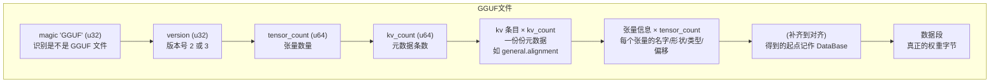
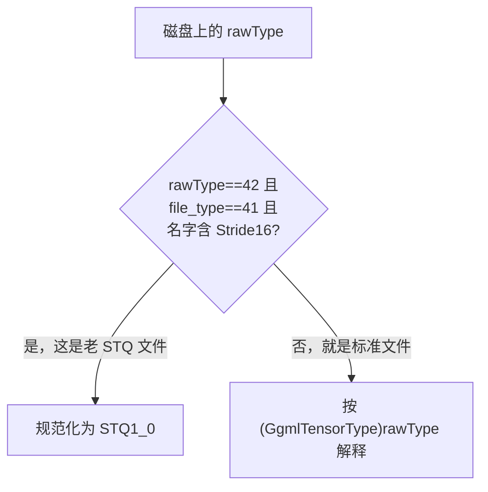

# 第 3 章 第一份代码：读取 GGUF 权重文件

> 面向初学者：本章是你动手写的第一份代码。我们会一起把一个二进制文件"拆开、安全地逐个字节读出来"。关键概念配 mermaid 图，每小节贴 `src/Qwen35Sharp.Gguf/GgufFile.cs` 的**真实源码**并加详细注释。

从这一章起我们写真正的代码。开发者遇到一个模型，第一件事永远是"把文件读进来"——模型本体住在 `.gguf` 文件里，读不进来后面全是空谈。

## 3.1 GGUF 在磁盘上长什么样

GGUF 是一种"封装格式"，很像快递纸箱：外面贴着表单（头部信息），里面塞着货物（权重字节）。它在磁盘上的布局非常规矩：



图里有两个"设计意图"，直接决定了后面的代码怎么写：

1. **元数据先来，数据段在最后**。解析器必须先读完所有 kv 条目，才能拿到一个关键信息 `general.alignment`（对齐值，默认 32）。只有知道对齐值，才能算出数据段从哪开始。
2. **张量信息只是"目录"**，权重字节按偏移去数据段里取。这带来一个爽点：**不需要把整个文件读进内存**，只查目录就能定位到任意一个张量、任意一块权重，这叫"秒开"。

对应真实代码——`src/Qwen35Sharp.Gguf/GgufFile.cs` 开头：

```csharp
/// <summary>
/// Memory-maps a GGUF v2/v3 file. Metadata is parsed immediately; tensor
/// payloads stay in the map and are addressed as DataBase + Offset.
/// 大白话：打开模型文件，立刻读出头部和目录；权重字节先别搬进内存，
/// 等用到时按"地址+偏移"直接去取。
/// </summary>
public sealed unsafe class GgufFile : IDisposable
{
    private const uint Magic = 0x46554747;     // "GGUF" 四个字节的小端写法（47='G'），用于识别文件
    private const uint DefaultAlignment = 32;  // 默认对齐：32 字节

    private Dictionary<string, object> _kv = [];      // 元数据字典：名字 → 值
    private Dictionary<string, GgufTensorInfo> _tensors = []; // 张量目录：名字 → 信息
    public byte* DataBase { get; private set; }        // 数据段起始指针
    public IReadOnlyDictionary<string, GgufTensorInfo> Tensors => _tensors;
```

## 3.2 用一个安全的游标顺序扫描

读二进制文件最怕**越界**——明明文件只有 100 字节，代码却读了 101 字节，会崩溃或读到垃圾数据。我们的对策，是设计一个"自带护栏"的游标（cursor）：它像一根探头，每次读取都先检查"前方筷子够不够长"，不够就立刻报错。

`GgufFile.cs` 末尾的 `private struct Cursor` 就是这个护栏（真实代码 + 详细注释）：

```csharp
private struct Cursor
{
    private readonly byte* _base;    // 文件基址（开头）
    private readonly long _length;   // 文件总长
    private long _pos;               // 当前读到的位置

    public readonly long Offset => _pos;   // 对外暴露"现在走到哪了"

    public ushort ReadU16()
    {
        Ensure(2);                    // 先检查：还想读 2 字节，够不够？
        ushort v = Unsafe.ReadUnaligned<ushort>(_base + _pos);  // 直接从左读 2 字节（小端）
        _pos += 2;
        return v;
    }

    public string ReadString()
    {
        ulong len = ReadU64();        // 字符串前面先把"长度"读出来
        if (len > int.MaxValue) throw new InvalidDataException("string too long");
        Ensure((long)len);            // 检查这段字符串有没有越界
        string s = Encoding.UTF8.GetString(new ReadOnlySpan<byte>(_base + _pos, (int)len));
        _pos += (long)len;
        return s;
    }

    private readonly void Ensure(long bytes)
    {
        if (_pos < 0 || bytes < 0 || _pos + bytes > _length)
            throw new EndOfStreamException("Unexpected end of GGUF file");  // 越界立刻报错
    }
}
```

三个要点（都是"为什么这么做"的理由）：

- **小端读法**：GGUF 的数值是小端存储（低位在前），我们用 `Unsafe.ReadUnaligned<T>` 直接读，不做拷贝。
- **越界即异常**：宁可让程序报错停住，也不悄悄读出错误数据——读坏一个数字比报错难查一万倍。
- **把解析变成"顺序读"**：有了这个游标，`Parse` 方法就是一行行"读这个、读那个"，像读说明书一样清晰。

## 3.3 内存映射：让 16 GB 权重"看起来"已经加载

有一个疑问很合理："几个 GB 的模型，难道要一下全读进内存？"——不，这正是 `GgufFile` 构造函数的精髓所在（真实代码）：

```csharp
public GgufFile(string path)
{
    ArgumentException.ThrowIfNullOrWhiteSpace(path);
    FileStream stream = new(path, FileMode.Open, FileAccess.Read, FileShare.Read, ...);
    long length = stream.Length;
    if (length < 24) throw new InvalidDataException($"GGUF file is too small: {length} bytes");

    try
    {
        _mmf = MemoryMappedFile.CreateFromFile(stream, null, length,
            MemoryMappedFileAccess.Read, HandleInheritability.None, leaveOpen: false);
        _view = _mmf.CreateViewAccessor(0, length, MemoryMappedFileAccess.Read);
        byte* ptr = null;
        _view.SafeMemoryMappedViewHandle.AcquirePointer(ref ptr);   // 拿到文件映射的基址指针
        _fileBase = ptr;
        Parse(length);            // 扫一遍头部，建目录
    }
    catch { stream?.Dispose(); Dispose(); throw; }
}
```

`MemoryMappedFile`（内存映射）的大白话解释：**程序并不真的把文件读进来，只是让操作系统"假装"文件就在内存里**。当你访问某个地址时，操作系统才把对应的一小块文件页加载进来（这叫"按需加载"）。好处：

- 打开几个 GB 的文件是**瞬间**的；
- 扫描头部元数据时只读开头几百字节，几乎零成本；
- 权重留在磁盘上，等 `LoadWeights`（第 8 章）需要时再去搬。

对外接口因此非常"窄而准"——它只暴露：`DataBase`（数据段起点指针）、`Tensors`（张量目录）、一组 `Get*` 元数据读取方法：

```csharp
public string GetString(string key, string defaultValue = "")
    => TryGet(key, out object? value) && value is not null && CoerceString(value, out string s) ? s : defaultValue;

public int GetInt32(string key, int defaultValue = 0)
    => TryGet(key, out object? value) && CoerceInt64(value, out long n) ? checked((int)n) : defaultValue;

public float GetFloat32(string key, float defaultValue = 0f)
    => TryGet(key, out object? value) && CoerceFloat(value, out float f) ? f : defaultValue;
```

**职责边界**：这里**不做**反量化、不做权重预处理——那是第 8 章 `LoadWeights` 的事。GGUF 读取器的本分是"把字节变成目录"。

## 3.4 宽容的元数据读取：一切都能强转

GGUF 元数据有个现实问题：**不同的工具导出的数值类型不一样**。同一个 `context_length`，工具 A 存成 u32、工具 B 存成 u64、工具 C 存成 i64。如果我们写死"只认 u32"，换个模型就报错。

解法是**宽容强转**：读出来的值，先统一试着转成 `long` / `float`，成功了就用，失败了再用默认值兜底（真实代码，`GgufFile.cs`）：

```csharp
private static bool CoerceInt64(object? value, out long n)
{
    switch (value)
    {
        case byte u8: n = u8; return true;
        case sbyte i8: n = i8; return true;
        case ushort u16: n = u16; return true;
        case short i16: n = i16; return true;
        case uint u32: n = u32; return true;
        case int i32: n = i32; return true;
        case ulong u64: n = checked((long)u64); return true;
        case long i64: n = i64; return true;
        default: n = 0; return false;
    }
}
```

这样不管模型用什么整数类型存，我们都能读成一致的 `int`。字符串也有对应的宽容：`CoerceString` / `CoerceStringArray` 逐个转。

## 3.5 张量清单：名字、类型、形状、偏移

元数据读完，还要拿到"张量目录"。这就是 `src/Qwen35Sharp.Gguf/GgufTensorInfo.cs` 的 `GgufTensorInfo`（带注释的真实代码）：

```csharp
public readonly struct GgufTensorInfo
{
    public GgmlTensorType Type { get; init; }      // 张量的数据类型（Q4_K？F32？…）
    /// <summary>Byte offset from GgufFile.DataBase (the aligned tensor blob).</summary>
    public ulong Offset { get; init; }             // 相对 DataBase 的字节偏移
    /// <summary>GGUF dims, dim 0 is the innermost (row) length.</summary>
    public ulong[] Shape { get; init; }            // 维度数组（注意：dim 0 是最内层，即"一行有多长"）

    public ulong NumElements
    {
        get
        {
            ulong n = 1;
            for (int i = 0; i < Shape.Length; i++)
                n = checked(n * Shape[i]);         // 各维度相乘 = 元素总数
            return n;
        }
    }
}
```

三个要点（都是初学者容易踩坑的地方）：

1. **`Type` 是什么**：`GgmlTensorType` 枚举（`GgmlTensorType.cs`），逐个列出模型里可能的量化类型。注意其中 `Q2_0C=40`、`STQ1_0=43` 是这个项目自定义的扩展类型。
2. **`Shape` 方向怎么读**：`Shape[0]` 是**最内层，也就是"一行有多长"**，跟 ggml（llama.cpp 的底层库）一致。这是 GGUF 头号陷阱——PyTorch 的直觉是"最后一维是行"，到这里要反过来。
3. **`Offset` 从哪算**：相对 `DataBase` 算，不是相对文件头。所以取权重的公式永远是 `DataBase + Offset`。

## 3.6 类型规范化的历史陷阱：type 42 到底是 Q2_0 还是 STQ

最后讲一个"格式层遇到的历史大坑"。llama.cpp 的 `ggml_type` 枚举在版本演进中**重排过编号**：早期某个模型把 STQ（稀疏三元）存成 type 42，后来 llama.cpp 重排枚举、type 42 变成了标准 Q2_0。结果就是：**一个编号，两种不同的含义**。



项目用"看伴随信号"来消歧——如果一个文件同时满足 rawType 42 + file_type 41 + 名字含 "Stride16"，那它一定是老 STQ；否则一律按最新标准解释（真实代码 `GgufFile.cs`）：

```csharp
private GgmlTensorType CanonicalTensorType(int rawType)
{
    // 老模型 HyMT2 Stride16 用的 type 42 和后来的标准 Q2_0 撞号了。
    // 只有同时满足 file_type==41 且名字含 "Stride16" 才把它当成 STQ，
    // 这样普通 Q2_0 文件永远不会被误读成 STQ。
    if (rawType == 42 && GetInt32("general.file_type", -1) == 41 &&
        GetString("general.name").Contains("Stride16", StringComparison.OrdinalIgnoreCase))
        return GgmlTensorType.STQ1_0;
    return (GgmlTensorType)rawType;
}
```

配套单测 `tests/Qwen35Sharp.Tests/GgufTypeTests.cs` 的 `LegacyStride16Type42IsNormalizedWithoutBreakingQ2` 用手写二进制把两条分支各钉一遍，保证"老 STQ 被认出、新 Q2_0 不被误读"。

> **一句话总结这一章**：`GgufFile` 用内存映射 + 带护栏的 `Cursor` + 顺序 `Parse` 把 `.gguf` 变成"元数据表 + 张量目录 + DataBase 指针"，`Coerce*` 宽容强转消化类型差异，`CanonicalTensorType` 守住历史边界。数据躺到面前了——下一章，把这些权重字节读成能计算的数字：量化格式。