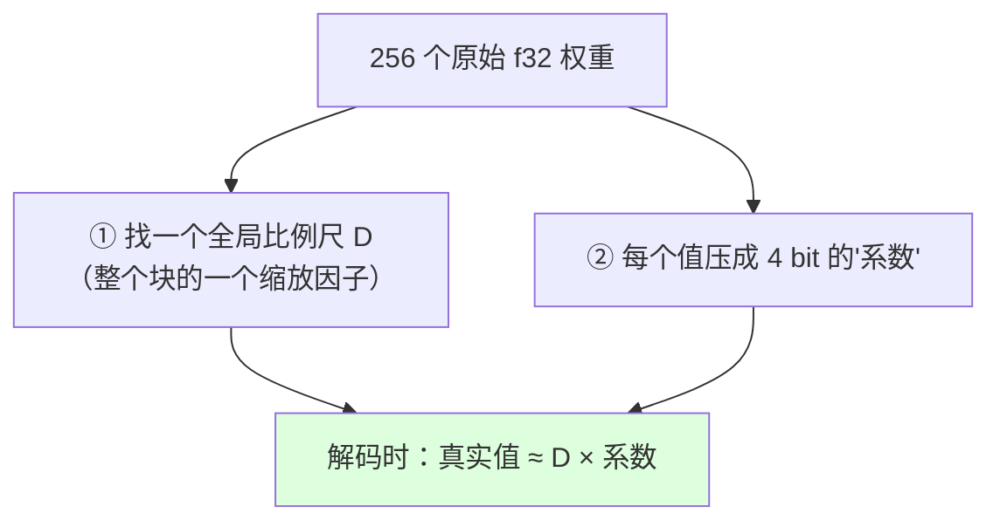

# 第 4 章 量化：为什么权重能塞进内存，以及怎么解码

> 面向初学者：本章解释"模型为什么能被压缩到那么小"。我们会用"用更少的数字记录一份数据"的比喻讲清楚，然后逐个看 `src/Qwen35Sharp.Kernels/BlockLayout.cs` 和各格式的**真实源码**，配 mermaid 图。

模型读进来了，但立刻撞上现实：**模型太大**。一个 4B 参数的模型，如果每个参数用 32 位浮点（f32）存，光权重就要 16 GB 内存，普通电脑装不下。于是有了**量化**（quantization）——把每个数字用更少的位（bit）去表示，牺牲一点精度换体积。这一章是后续所有高效计算的地基，也是我们必须"读字节地图"的地方。

## 4.1 从"一个 f32"到"256 个值一个块"的思维转换

先建立一个贯穿全书的视角：**K 系量化格式，都共享"super-block = 256 个值"的分块思想**。

所谓 super-block（超级块），意思是：**256 个权重值共享一套"缩放比例"**。为什么是 256 个一起共享？因为模型里相邻的权重数值往往"差不多大小"——它们来自同一条平滑的分布曲线。既然数值接近，就可以：

1. 给整块记一个"比例尺"（scale）；
2. 每个权重只记"相对比例尺的倍数"，倍数用很少的 bit 表示（比如 4 bit 能表示 0~15）；
3. 读的时候：`真实值 ≈ 比例尺 × 倍数`。



项目里所有尺寸常量都集中在一个 `Qk` 静态类里（`BlockLayout.cs`）——它就是"字节地图的图例"，后面写内核时几乎每行都查它：

```csharp
public static class Qk
{
    public const int SuperBlock = 256;      // 每个超级块装 256 个值
    public const int ScaleBytes = 12;       // Q4_K/Q5_K 的缩放信息占 12 字节
    public const int Q4KSize = 144;         // 一个 Q4_K 块占 144 字节
    public const int Q8KSize = 292;         // 一个 Q8_K 块占 292 字节
    public const int Q4Kx8Size = 1152;      // 8 列 Q4_K 面板块（第 6 章）
    public const int Q4Kx8MetaSize = 448;   // 面板的预解码元数据
    public const int Q8Kx4Size = 1168;      // 4 行 Q8_K 面板块（第 6 章）
    public const int Q5KSize = 176;
    public const int Q6KSize = 210;
    public const int IQ4XSSize = 136;
    public const int Q2_0CSize = 130;       // 512 值一个块
    public const int STQ1_0Size = 42;
    // ...（其余面板尺寸）
}
```

所有块结构体都带 `[StructLayout(LayoutKind.Sequential, Pack = 1)]`，意思是"结构体内存布局和 C 语言一致，一个字节不多一个字节不少"——这样内存里的二进制布局才能和磁盘上的 GGUF 文件精确对上。

## 4.2 Q4_K：128 nibble + 12 字节 scales

Q4_K 是最主流的权重格式，意思是**每个权重用 4 bit（半个字节）表示**。先看它在内存里的真实结构（带注释版）：

```csharp
[StructLayout(LayoutKind.Sequential, Pack = 1)]
public unsafe struct BlockQ4K
{
    public ushort D;                             // D：整个块的全局比例尺（fp16）
    public ushort Dmin;                          // Dmin：全局最小值（减均值用）
    public fixed byte Scales[Qk.ScaleBytes];     // 12 字节：8 个子块各自的 scale/min（6-bit 打包）
    public fixed byte Qs[Qk.SuperBlock / 2];     // 128 字节：256 个 4-bit 值，每字节装 2 个
}
```

解码时按子块进行（真实函数 `src/Qwen35Sharp.Kernels/Q4K.cs`）：

```csharp
public static void GetScaleMin(int j, byte* scales, out byte scale, out byte min)
{
    // llama.cpp 的 6-bit 打包：每 4 个子块一组，
    // 前 4 个子块的 scale/min 直接取低 6 位（&63），
    // 后 4 个子块的 scale/min 需要跨字节拼位。这里就是"位手术"。
    if (j < 4)
    {
        scale = (byte)(scales[j] & 63);        // 取低 6 位作为 scale
        min = (byte)(scales[j + 4] & 63);      // 取低 6 位作为 min
        return;
    }
    scale = (byte)((scales[j + 4] & 0xF) | ((scales[j - 4] >> 6) << 4));   // 拼位
    min   = (byte)((scales[j + 4] >> 4) | ((scales[j] >> 6) << 4));
}
```

真正把一行反量化出来的是 `DequantizeRow`（真实代码，带注释）：

```csharp
public static void DequantizeRow(BlockQ4K* x, float* y, int k)
{
    int nb = k / Qk.SuperBlock;
    for (int i = 0; i < nb; i++)                    // 对每个超级块
    {
        byte* q = x[i].Qs;                          // 指向 4-bit 数据区
        float d   = HalfBits.ToSingle(x[i].D);      // 全局比例尺
        float min = HalfBits.ToSingle(x[i].Dmin);   // 全局最小值
        int iscale = 0;
        for (int j = 0; j < Qk.SuperBlock; j += 64) // 每次处理 64 个值（两个子块）
        {
            GetScaleMin(iscale + 0, x[i].Scales, out byte sc0, out byte min0);
            GetScaleMin(iscale + 1, x[i].Scales, out byte sc1, out byte min1);
            float d1 = d * sc0;  float m1 = min * min0;   // 子块 0 的有效尺度和最小值
            float d2 = d * sc1;  float m2 = min * min1;   // 子块 1 的有效尺度和最小值
            for (int l = 0; l < 32; l++) *y++ = d1 * (q[l] & 0xF) - m1;   // 低 nibble
            for (int l = 0; l < 32; l++) *y++ = d2 * (q[l] >> 4) - m2;    // 高 nibble
            q += 32; iscale += 2;
        }
    }
}
```

`PackSimple` 只是测试用具（把随机 f32 压成 Q4_K 的最小打包器）——真正的量化发生在模型发布端，我们推理时只需要"解码"。

## 4.3 Q8_K：全程通用的激活中间格式

decode 还有半边天是**激活**——每一层的输入向量。它也要量化，但用一个不同的格式：Q8_K（每权重 8 bit 有符号字节）。`BlockQ8K` 结构：

```csharp
[StructLayout(LayoutKind.Sequential, Pack = 1)]
public unsafe struct BlockQ8K
{
    public float D;                            // f32 块尺度
    public fixed sbyte Qs[Qk.SuperBlock];      // 256 个有符号字节
    public fixed short Bsums[Qk.SuperBlock / 16]; // 每 16 个 Qs 的和——给 Q2/Q6/STQ 均值修正用
}
```

`Q8K.QuantizeRow`（`src/Qwen35Sharp.Kernels/Q8K.cs`）把一行 f32 压缩成 Q8_K。它的定标规则每一步都有讲究（真实代码，含关键注释）：

```csharp
public static void QuantizeRow(float* x, BlockQ8K* y, int k)
{
    int nb = k / Qk.SuperBlock;
    for (int i = 0; i < nb; i++)
    {
        float iscale = ScaleBlock(x + i * Qk.SuperBlock, out float delta);
        if (iscale == 0)                          // 整块全零 → 直接写零，避免 -127/0 得 NaN
        {
            y[i].D = 0;
            NativeMemory.Clear(y[i].Qs, (nuint)Qk.SuperBlock);
            continue;
        }
        y[i].D = delta;
        sbyte* qs = y[i].Qs;
        if (Avx2.IsSupported)                     // 快速路径：一次处理 8 个
        {
            Vector256<float> isv = Vector256.Create(iscale);
            Vector256<int> lo = Vector256.Create(-127), hi = Vector256.Create(127);
            for (int j = 0; j < Qk.SuperBlock; j += 8)
            {
                Vector256<float> rounded = Avx.RoundToNearestInteger(
                    Avx.Multiply(Avx.LoadVector256(src + j), isv));   // 值 × 尺度
                Vector256<int> qi = Avx2.Min(Avx2.Max(Avx.ConvertToVector256Int32(rounded), lo), hi);
                // PackSignedSaturate 饱和打包成 sbyte：超过 127 就压到 127
            }
        }
        else                                      // 慢速兜底：逐个算
        {
            for (int j = 0; j < Qk.SuperBlock; j++)
                qs[j] = (sbyte)Math.Clamp((int)MathF.Round(iscale * src[j]), -127, 127);
        }
        // ... 随后算 Bsums（每 16 个值的和） ...
    }
}
```

`ScaleBlock` 的定标规则值得用显微镜看一遍（真实代码，两处关键注释）：

```csharp
public static float ScaleBlock(float* src, out float delta)
{
    // 先找 absmax（绝对值最大的数）……
    // 然后找"第一个出现的、等于 ±absmax 的位置"：
    //   如果先碰到 -absmax，取 max = -amax，否则取 max = +amax。
    // 为什么要找"第一个出现"而不是直接用 amax？因为 llama.cpp 的参考实现
    // 就是这样做，我们要和它逐位一致，这样调试对拍才能通过。
    float iscale = -127f / max;
    delta = 1f / iscale;
    return iscale;
}
```

## 4.4 Q5_K 与 Q6_K：在精度与体积之间的两个档位

Q4_K 是最主流，但模型发布者也会按"内存预算 vs 精度需求"选择更高档位。

### Q5_K（每值 5 bit）

5 bit 比 4 bit 多出 1 bit——多出的"第 5 位"没地方放，于是单独存进 `Qh` 数组：

```csharp
[StructLayout(LayoutKind.Sequential, Pack = 1)]
public unsafe struct BlockQ5K
{
    public ushort D;
    public ushort Dmin;
    public fixed byte Scales[Qk.ScaleBytes];
    public fixed byte Qh[Qk.SuperBlock / 8];   // 第 5 位位图：每字节管 8 个值的第 5 位
    public fixed byte Qs[Qk.SuperBlock / 2];   // 低 4 位
}
```

解码时 `q = (Qs[l] & 0xF) + ((Qh[l] & mask) ? 16 : 0)`——低位 4 bit 加上第 5 位的 16。Q5_K **没有面板**（第 6 章会看到原因），prefill 时退化为逐 token GEMV。

### Q6_K（每值 6 bit）

```csharp
[StructLayout(LayoutKind.Sequential, Pack = 1)]
public unsafe struct BlockQ6K
{
    public fixed byte Ql[Qk.SuperBlock / 2];   // 低 4 位
    public fixed byte Qh[Qk.SuperBlock / 4];   // 高 2 位
    public fixed sbyte Scales[Qk.SuperBlock / 16]; // 每 16 个值一个尺度（零中心）
    public ushort D;
}
```

它的 AVX2 内核（第 5 章）用 m3/m12/m48/mC0 四个掩码把高 2 位"提升"成高 nibble，与低 4 位拼成 0..63。

## 4.5 低比特家族：Q2_0C 与 STQ1_0

这两个是非常激进的设计。

### Q2_0C（每值 2 bit，512 值一块）

值域故意选 **{-3,-1,1,3}**——**没有零**：

```csharp
[StructLayout(LayoutKind.Sequential, Pack = 1)]
public unsafe struct BlockQ2_0C
{
    public ushort D;                              // 512 值共享一个 fp16 尺度
    public fixed byte Qs[Qk.SuperBlock * 2 / 4];  // 128 字节：512 个 2-bit 码，每字节 4 个
}

public const int BlockLength = 512;
public static int Value(byte b, int shift) => ((b >> shift) & 3) * 2 - 3;   // 0->-3,1->-1,2->1,3->3
```

### STQ1_0（稀疏三元）

它的设计很"另类"：**每 256 个值里，分成许多小组，每组恰好"一个零、三个相等的非零值"**——所以叫"稀疏三元"（只有 -1/0/+1 三种可能）。用一个 32 项码本编码（`STQ1_0.cs` 的真实代码）：

```csharp
[StructLayout(LayoutKind.Sequential, Pack = 1)]
public unsafe struct BlockSTQ1_0
{
    public fixed byte Qs[Qk.STQ1_0BlockLength / 8];   // 组索引
    public fixed byte Sign[Qk.STQ1_0BlockLength / 32]; // 符号位
    public ushort D;
}

// 第 4 章提过：QPack 从 Qs 里取 4-bit slot、从 Sign 里取 1-bit 符号，
// 合起来查 32 项码本得到 "4 lane 的 2-bit 模式"。
internal static byte QPack(BlockSTQ1_0* x, int group)
{
    int slot = (x->Qs[group >> 1] >> ((group & 1) * 4)) & 0x0F;
    int sign = (x->Sign[group >> 3] >> (group & 7)) & 1;
    return Codebook[(sign << 4) | slot];
}
```

## 4.6 IQ4_XS：非线性网格的争议与价值

IQ4_XS 也是 4 bit，但它**不信任线性网格**。普通的 4 bit 是 "0,1,2,…15" 均匀分布；IQ4_XS 用一套非均匀的数值，让小数值（权重里最常见）分得更细，大数值（少见）分得粗：

```csharp
private static readonly int[] KValues =
{
    -127, -104, -83, -65, -49, -35, -22, -10, 1, 13, 25, 38, 53, 69, 89, 113,
};
```

它是 MoE 专家的首选低比特格式（第 12 章反复出现）。

## 4.7 fp16 与软件 cvtph：没有 F16C 也要向量化

很多块里的尺度字段是 fp16（半精度浮点）。老 CPU 可能没有硬件转换指令，于是项目手写了软件版 `cvtph_ps`（`HalfBits.Load8`，`BlockLayout.cs`）：一次把 8 个 fp16 装进 `Vector256<float>`，把"每次 1 个标量转换"变成"一个向量指令"。

```csharp
public static class HalfBits
{
    public static float ToSingle(ushort bits) => (float)BitConverter.UInt16BitsToHalf(bits);

    /// <summary>AVX2 software cvtph_ps for finite normals and signed zeros (GGUF d/dmin).</summary>
    [MethodImpl(MethodImplOptions.AggressiveInlining)]
    public static unsafe Vector256<float> Load8(ushort* src)
    {
        // 手动把 8 个 fp16 拆成 符号位/指数/尾数，再拼回 f32。
        // 对"有穷正规数 + 符号零"逐位逼近硬件指令。
        if (Avx2.IsSupported) { /* ...位运算实现... */ }
        return Vector256.Create(ToSingle(src[0]), ToSingle(src[1]), /* ... */);
    }
}
```

> **一句话总结这一章**：K 系量化共享 super-block=256 + 分层 scale/min 骨架，`Q4K`/`Q8K`/`Q5K`/`Q6K`/`Q2_0C`/`STQ1_0`/`IQ4XS` 各自的布局与解码在 `BlockLayout.cs` 的块结构体和各自的静态类里逐一落地；`HalfBits.Load8` 让 fp16 字段无 F16C 也向量化。数据的地图画完了——下一个问题：这些被压进几个 bit 的字节，怎么在 CPU 上飞快乘起来？第 5 章，点积与 GEMV。