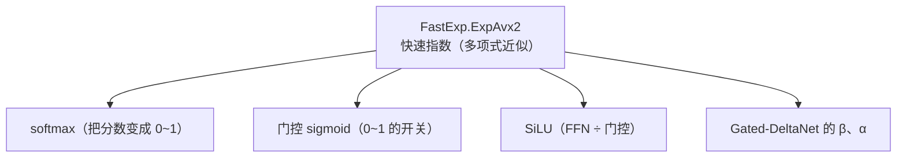

# 第 5 章 最小计算单元：量化点积与 GEMV

> 面向初学者：本章讲解推理中最核心的一个动作——"两个数组逐个相乘再求和"（点积）。我们由浅入深：先看懂平凡版本，再看懂 AVX2 加速版。每小节贴 `src/Qwen35Sharp.Kernels/` 的**真实源码**并配图。

前四章我们拥有了"读文件的能力"和"认识字节地图的能力"。这一章，计算真正开始：从最小单元"一行权重 × 一行激活"出发，造出 decode 每生成一个 token 都要跑的那个路径。

这一章的走法：我们**首先**弄明白 decode 的第一性原理——它为什么离不开"一次新量化的行向量"（5.1 节）；**其次**看 Q8_K 激活怎么量化出来（5.2 节）；**接着**从标量到 AVX2 一路看懂 Q4_K×Q8_K 的点积（5.3 节）；**然后**快速扫过其余格式（Q6_K、Q2_0C、IQ4_XS、STQ1_0、Q5_K）的点积（5.4 节）；**还要**认识 FastExp 与 SiLU 这对硬件快车道（5.5 节）；**最后**把它拼成完整的 GEMV，并聊聊"为什么每个内核都配一个标量兄弟"（5.6、5.7 节）。

## 5.1 decode 的第一性原理：为什么它离不开新量化的行向量

先弄清楚 decode（生成一个字）在干什么。自回归模型是"一次生成一个字"的循环：

1. 把整段提示词一次性处理完（这叫 **prefill**），得到第一个字的分数；
2. 挑分数最高的那个字，**接到句子末尾**，再处理一次（这叫 **decode**），得到第二个字；
3. 重复第 2 步，直到遇到"结束符"。

关键在第 2 步：每次输入其实只有**一个 token**。模型要做的事是：让这个 token 的向量（记作 x）和**所有权重行**分别做点积，得到一个"输出向量"。数学上这叫**矩阵乘以向量**（GEMV，Matrix-Vector product），而不是"矩阵乘以矩阵"。

```mermaid
graph LR
    subgraph GEMV（一次 decode）
        X["一个 token 的向量 x<br/>(1 × nIn)"] --> DOT["对每一行权重 w_i<br/>算点积：y_i = Σ_j x_j·w_ij"]
        W["权重矩阵<br/>(nOut × nIn 行)"] --> DOT
        DOT --> Y["输出行 y（1 × nOut）"]
    end
```

因为输入只有一行，我们可以先把它**量化一次**，然后所有权重行都跟这同一个量化结果点积——这叫"一次量化、处处复用"。它的代码入口是 `src/Qwen35Sharp.Kernels/MulMatQ4K.cs` 的 `Gemv`：

```csharp
public static void Gemv(BlockQ4K* weights, float* input, float* output,
    int nIn, int nOut, CpuThreadPool? pool = null, ScratchArena? scratch = null)
{
    // 1) 给 Q8_K 激活行申请一块临时内存（尽量用 scratch 竞技场，避免反复 new）
    nuint q8Bytes = (nuint)Q8K.RowBytes(nIn);
    NativeBuffer? owned = scratch == null ? new NativeBuffer(q8Bytes) : null;
    BlockQ8K* y = (BlockQ8K*)(scratch != null ? scratch.D(q8Bytes) : owned!.Pointer);
    try
    {
        // 2) 把输入 f32 行量化成 Q8_K（一次）
        Q8K.QuantizeRow(input, y, nIn);
        // 3) 用这个量化行，对每一行权重做点积
        GemvPrequant(weights, y, output, nIn, nOut, pool);
    }
    finally { owned?.Dispose(); }
}
```

`GemvPrequant` 把输出行按几个 worker 平分，每个 worker 负责连续的一段行——这是为了让每个线程访问的内存尽量连续（缓存友好）：

```csharp
public static void GemvPrequant(BlockQ4K* weights, BlockQ8K* y, float* output,
    int nIn, int nOut, CpuThreadPool? pool = null)
{
    int nb = nIn / Qk.SuperBlock;
    void Body(int worker, int workers)
    {
        int begin = nOut * worker / workers;   // 本 worker 负责的行起点
        int end = nOut * (worker + 1) / workers; // 终点
        for (int row = begin; row < end; row++)
            output[row] = VecDotQ4K.Dot(weights + row * nb, y, nIn);  // 点积！
    }
    if (pool == null) Body(0, 1);      // 没线程池就单线程
    else pool.For(nOut, Body);         // 有线程池就并行
}
```

## 5.2 Q8_K 激活量化：把一行 f32 变成一行 8-bit

第 4 章看过 `BlockQ8K` 的结构；这一节看它怎么被填满——`Q8K.QuantizeRow`。核心思想：找到"比例尺"，让每个数除以比例尺、再四舍五入成一个字节。

```csharp
public static float ScaleBlock(float* src, out float delta)
{
    // 第 4 章提过：先找 absmax，再区别"第一个出现的是 +max 还是 -max"，
    // 目的是和 llama.cpp 参考实现逐位一致。
    float iscale = -127f / max;
    delta = 1f / iscale;
    return iscale;
}
```

## 5.3 Q4_K × Q8_K 的点积：从标量到 AVX2

点积函数 `VecDotQ4K.Dot` 是最有象征意义的一个。先看"入口 + 标量参考版"（真实代码，`src/Qwen35Sharp.Kernels/VecDotQ4K.cs`）：

```csharp
public static float Dot(BlockQ4K* x, BlockQ8K* y, int n)
    => Avx2.IsSupported ? DotAvx2(x, y, n) : DotScalar(x, y, n);   // 能加速就加速，否则标量兜底
```

标量版 `DotScalar` 用来做什么？它有两个作用：① 在没有 AVX2 的老 CPU 上仍能正确计算；② 作为**正确性参考**——加速版算出来对不对，拿它来对答案。这是贯穿全书的铁律（5.7 详讲）。

```csharp
public static float DotScalar(BlockQ4K* x, BlockQ8K* y, int n)
{
    int nb = n / Qk.SuperBlock;
    uint* utmp = stackalloc uint[4];
    sbyte* aux8 = stackalloc sbyte[Qk.SuperBlock];   // 临时解出的一整块 Q4 值
    float sumf = 0;
    for (int i = 0; i < nb; i++)
    {
        // 1) 把 Q4_K 的 nibble 全部解成有符号字节，存进 aux8
        byte* q4 = x[i].Qs; sbyte* q8 = y[i].Qs; sbyte* a = aux8;
        for (int j = 0; j < Qk.SuperBlock / 64; j++)
        {
            for (int l = 0; l < 32; l++) a[l] = (sbyte)(q4[l] & 0xF);       // 低 nibble
            a += 32;
            for (int l = 0; l < 32; l++) a[l] = (sbyte)(q4[l] >> 4);        // 高 nibble
            a += 32; q4 += 32;
        }

        // 2) 解出子块尺度
        Q4K.UnpackScales(x[i].Scales, utmp);
        byte* scales = (byte*)utmp;  byte* mins = (byte*)(utmp + 2);

        // 3) 求和修正项 sumi = Σ Bsums·mins（后面减掉，以还原"减 min"的语义）
        int sumi = 0;
        for (int j = 0; j < Qk.SuperBlock / 16; j++)
            sumi += y[i].Bsums[j] * mins[j / 2];

        // 4) 每个 32 值子块：acc += scale * (q8[j] * aux[j])
        a = aux8; q8 = y[i].Qs;
        int iscale = 0, acc = 0;
        for (int j = 0; j < Qk.SuperBlock / 32; j++)
        {
            int scale = scales[iscale++];
            for (int l = 0; l < 32; l++) acc += scale * q8[l] * a[l];
            q8 += 32; a += 32;
        }

        // 5) 还原成 f32：sumf += D·acc - Dmin·sumi
        float d = HalfBits.ToSingle(x[i].D) * y[i].D;
        float dmin = HalfBits.ToSingle(x[i].Dmin) * y[i].D;
        sumf += d * acc - dmin * sumi;
    }
    return sumf;
}
```

**为什么解码慢？** 因为循环里反复做位手术、移位、解包。AVX2 的目标就是"让 CPU 最擅长的乘加指令一口气算 8 个"，而把位手术提前做完。

AVX2 版 `DotAvx2` 的精髓是 **`vpmaddubsw`**——一条指令完成"16 个字节 × 16 个字节 → 8 个短整数乘加"。量化数据正好是字节对，所以它就是为量化点积而生的。热点代码如下（节选，带注释）：

```csharp
public static float DotAvx2(BlockQ4K* x, BlockQ8K* y, int n)
{
    // mask 0x0F 用于取低 nibble
    Vector256<byte> m4 = Vector256.Create((byte)0x0F);
    Vector256<float> acc = Vector256<float>.Zero;      // 8 个并行累加槽
    Vector128<float> accMin = Vector128<float>.Zero;  // 独立的"减 min"累加槽

    for (int i = 0; i < nb; i++)
    {
        Q4K.UnpackScales(x[i].Scales, utmp);          // 预先解好尺度
        // ... 展开低/高 nibble ...
        // vpmaddubsw(q4l, q8l)：8 对乘加 -> 8 个 int16
        Vector256<short> p16l = Avx2.MultiplyAddAdjacent(q4l, q8l);
        // 再乘子块尺度、拓宽成 int32，加入 sumi
        Vector256<int> p32l = Avx2.MultiplyAddAdjacent(p16l, scaleL.AsInt16());
        sumi = Avx2.Add(sumi, Avx2.Add(p32l, p32h));
        // ...
    }
    // 最后 FMA 合并 D，减去 accMin，水平求和
    return HorizontalSum(acc) + accMin.ToScalar();
}
```

这里有一个必须写进注释的**溢出审计**：`vpmaddubsw` 每对乘积最大 ≤ 255×127，8 对和进一个 int16 正好安全。做内核时，每一级中间累加都要写一句话证明"最坏情况在这个位宽里安全"。

## 5.4 其余格式的点积：Q6_K、Q2_0C、IQ4_XS、STQ1_0、Q5_K

一个格式的引擎不是引擎。逐个看其余格式的点积实现与参考锚点。

### Q6_K（`Q6K.Dot`/`DotScalar`/`DotAvx2`）

标量参考 `DotScalar` 展示了"展开 6-bit → 减 32 中心化 → 每 16 值尺度"的整体结构：

```csharp
public static float DotScalar(BlockQ6K* x, BlockQ8K* y, int n)
{
    int nb = n / Qk.SuperBlock;
    sbyte* aux = stackalloc sbyte[Qk.SuperBlock];
    for (int i = 0; i < nb; i++)
    {
        // 展开 q = (Ql 低4位 | Qh 高2位) - 32   （减 32 是中心化）
        byte* q4 = x[i].Ql; byte* qh = x[i].Qh; sbyte* a = aux;
        for (int j = 0; j < Qk.SuperBlock; j += 128)
        {
            for (int l = 0; l < 32; l++)
            {
                a[l]      = (sbyte)(((q4[l]      & 0xF) | ((qh[l] & 3)     << 4)) - 32);
                a[l + 32] = (sbyte)(((q4[l + 32] & 0xF) | (((qh[l] >> 2) & 3) << 4)) - 32);
                a[l + 64] = (sbyte)(((q4[l] >> 4) | (((qh[l] >> 4) & 3) << 4)) - 32);
                a[l + 96] = (sbyte)(((q4[l + 32] >> 4) | (((qh[l] >> 6) & 3) << 4)) - 32);
            }
            a += 128; q4 += 64; qh += 32;
        }
        // 每 16 值乘一个尺度累加
        int acc = 0;
        a = aux; sbyte* q8 = y[i].Qs;
        for (int j = 0; j < Qk.SuperBlock / 16; j++)
        {
            int scale = x[i].Scales[j];
            for (int l = 0; l < 16; l++) acc += scale * q8[l] * a[l];
            q8 += 16; a += 16;
        }
        sumf += HalfBits.ToSingle(x[i].D) * y[i].D * acc;
    }
    return sumf;
}
```

AVX2 版 `DotAvx2` 用 m3/m12/m48/mC0 掩码把 `Qh` 的四对 2-bit 提升成 4 位。`DotAvx2x4`（4 行点积）是 prefill 4-token 步进的预告。

### Q2_0C（`Q2_0C.Dot`/`DotScalarForTest`/`DotAvx2`）

```csharp
public static float Dot(BlockQ2_0C* x, BlockQ8K* y, int n) =>
    Avx2.IsSupported ? DotAvx2(x, y, n) : DotScalarForTest(x, y, n);

public static float DotScalarForTest(BlockQ2_0C* x, BlockQ8K* y, int n)
{
    float sum = 0;
    for (int b = 0; b < n / BlockLength; b++)   // 每 512 值一块
    {
        int s0 = 0, s1 = 0;
        for (int j = 0; j < 256; j++)           // 前半 256 对 y[2b]，后半对 y[2b+1]
        {
            s0 += Value(x[b].Qs[j / 4], (j & 3) * 2) * y[b * 2].Qs[j];
            s1 += Value(x[b].Qs[64 + j / 4], (j & 3) * 2) * y[b * 2 + 1].Qs[j];
        }
        sum += HalfBits.ToSingle(x[b].D) * (s0 * y[b * 2].D + s1 * y[b * 2 + 1].D);
    }
    return sum;
}
```

AVX2 版 `DotAvx2` 的 `Dot256` 用"字节 → dword → 拆独立字节"的寄存器技巧展开 2-bit 码，不做标量解包也不临时存权重。

### IQ4_XS（`IQ4XS.Dot`）

查表免展开：

```csharp
public static float Dot(BlockIQ4XS* x, BlockQ8K* y, int n)
{
    int nb = n / Qk.SuperBlock;
    for (int i = 0; i < nb; i++)
    {
        byte* qs = x[i].Qs; sbyte* q8 = y[i].Qs; float d8 = y[i].D;
        for (int ib = 0; ib < Qk.SuperBlock / 32; ib++)
        {
            SubBlockScale(&x[i], ib, out float dl, out _);   // 子块有效尺度
            int acc = 0;
            for (int j = 0; j < 16; j++)
            {
                acc += q8[j]      * KValues[qs[j] & 0xF];   // 低 nibble 查表
                acc += q8[j + 16] * KValues[qs[j] >> 4];    // 高 nibble 查表
            }
            sumf += dl * acc * d8;
            qs += 16;
        }
    }
    return sumf;
}
```

### STQ1_0（`STQ1_0.DotScalar`/`DotAvx2`）

标量版直接演示"码本 → lane → 乘 Q8 激活"：

```csharp
public static float DotScalar(BlockSTQ1_0* x, BlockQ8K* y, int n)
{
    for (int b = 0; b < n / BlockLength; b++)
    {
        int si = 0;
        for (int g = 0; g < BlockLength / 4; g++)
        {
            byte qpack = QPack(x + b, g);                    // 查码本得出 4 lane 的 2-bit 模式
            int chunk = g >> 4, gloc = g & 15;
            for (int lane = 0; lane < 4; lane++)
                si += Lane(qpack, lane) * y[b].Qs[chunk * 64 + gloc + lane * 16];   // -1/0/+1 与激活乘
        }
        sum += HalfBits.ToSingle(x[b].D) * y[b].D * si;
    }
    return sum;
}
```

### Q5_K（`Q5K.Dot`）

与 Q4_K 的 `DotScalar` 基本同构，只是展开时多了"第 5 位"：`q = nibble + ((Qh & mask) ? 16 : 0)`。

## 5.5 硬件快车道：FastExp 与 SiLU

除了点积，decode 路径还有一大类高频算子：**逐元素非线性**——softmax 里的指数（exp）、FFN 里的 SiLU、门控里的 sigmoid。用一个图看清它们的角色：



`src/Qwen35Sharp.Kernels/FastExp.cs` 是 llama.cpp `ggml_v_expf` 的逐位移植（真实代码，核心片段）：

```csharp
public static Vector256<float> ExpAvx2(Vector256<float> x)
{
    // 思路：exp(x) = 2^(1.4427·x)。先乘以 log2(e) 得到"指数 n"，
    // 然后用一个 f32 多项式逼近 2 的小数次幂，最后移位还原。
    Vector256<float> r = Vector256.Create(12582912f);
    Vector256<float> z = Fma.MultiplyAdd(x, Vector256.Create(1.4426950216293335f), r);
    Vector256<float> n = Avx.Subtract(z, r);
    // 多项式项（n 的 0..4 次幂），这是从 llama.cpp 精确抄来的系数……
    // 边界：|n|>126 → +inf；否则用分段乘法还原 2^n
}
public static Vector256<float> SiluAvx2(Vector256<float> x)
{
    Vector256<float> expNeg = ExpAvx2(Avx.Subtract(Vector256<float>.Zero, x));  // exp(-x)
    return Avx.Divide(x, Avx.Add(Vector256<float>.One, expNeg));                // x/(1+e^-x)
}
```

## 5.6 把它拼成 GEMV：逐行循环中的缓存与并行

`MulMatQ4K.Gemv` 已在 5.1 见过（量一次、逐行点积、worker 等分布、scratch 拿 Q8、无 AVX2 回退标量）。几个工程细节：

- **尾部处理**：`nIn` 不整除 super-block 时，主体大步 + 尾部细补救。
- **worker 等分布**：保证每个 worker 扫连续段，缓存友好。
- **无 AVX2 回退**：`Dot` 在无 AVX2 时走 `DotScalar`——正确（慢）是底线。

## 5.7 正确性锚点：为什么每个内核都配一个标量兄弟

在"从零自制"的项目里，没人替你验证"算得对"。唯一的"标准答案"是：**你自己写的、独立的、可读的标量参考实现**。这就是"参考对拍"方法论，三条铁律：

1. **每个 SIMD 内核都有一个标量版本**：`DotScalarForTest`（Q2）、`DotScalar`（Q6/STQ）、`DequantizeRow`、`Quantize4x8Scalar`。
2. **测试 = 随机输入 + 对拍 + 容差**：`IQ4XSTests.Dot_MatchesScalarDequant` 把 `IQ4XS.Dot` 和"反量化后点积"对比。
3. **融合路径必须逐位守恒**：第 6 章 `Quantize4x8Silu` 要断言与朴素路径逐字节一致。

> **一句话总结这一章**：decode = 一次 `Q8K.QuantizeRow` + 每行权重做量化点积（`VecDotQ4K.Dot`/`Q6K.Dot`/`Q2_0C.Dot`/`IQ4XS.Dot`/`STQ1_0.Dot`/`Q5K.Dot`），`MulMatQ4K.Gemv` 把这串成完整 decode；`FastExp` 提供全引擎非线性引擎。但悬着一个问题：**decode 一行行算，prefill 要一次吃下整段提示词——逐行 GEMV 撑得住吗？** 答案在下一章：面板重打包与 panel GEMM。