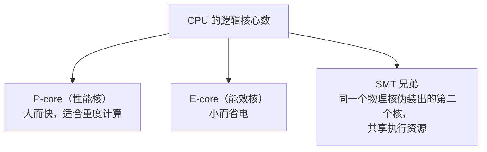

# 第 7 章 让多核为我们工作：线程池、拓扑与内存

> 面向初学者：本章讲"怎么让 CPU 的多个核心一起干活"，以及"内存怎么分配才高效"。每小节贴 `src/Qwen35Sharp.Kernels/` 的**真实源码**，用比喻解释线程、亲和性、对齐。

第 5、6 章的 SIMD 内核用 CPU 的"宽度"（一次算 8 个数）；这一章我们动用 CPU 的"数量"（多个核心同时算）。单线程跑 prefill GEMM，等于买了一台八缸发动机却只点一个缸。这一章回答三件事：**开多少线程**（拓扑）、**怎么派发**（线程池）、**内存在哪活**（原生缓冲与竞技场）。

## 7.1 不该用 Environment.ProcessorCount：CPU 拓扑发现

只带走一句话：**不要用 `Environment.ProcessorCount`（逻辑核心数）直接决定线程数。**

为什么？现代 CPU 的"逻辑核心"数里掺着三样东西：



对 GEMM 这种"所有线程做同一件事、步调一致推进"（lockstep）的计算来说：把两个线程塞进同一个物理核的 SMT 兄弟，等于两人抢一个厨房——谁也没变快，还互相拖慢；一个 E-core 混进 P-core 队伍，整条流水线被它拖到慢节奏。所以我们要的线程数是**物理 P-core 的数量**。

`src/Qwen35Sharp.Kernels/CpuTopology.cs` 的 `CpuTopology` 负责"数清楚物理核"。它的静态构造去操作系统问：

```csharp
static CpuTopology()
{
    int logical = Math.Max(1, Environment.ProcessorCount);   // 逻辑核数（参考，不作唯一依据）
    LogicalCount = logical;
    IsVirtualMachine = DetectVirtualMachine();               // 判断是不是虚拟机
    List<Core> cores = [];
    // Windows 用 GetLogicalProcessorInformationEx 拿"效率类"，Linux 读 /sys/devices/...
    if (OperatingSystem.IsWindows())  TryQueryWindows(cores);
    else if (OperatingSystem.IsLinux()) TryQueryLinux(cores);
    cores.Sort(CompareCores);
    // 统计 SMT、物理核数、P 核数……
    int workers = ChooseWorkerCount(logical, cores.Count, pCores.Count, sawSmt, IsVirtualMachine);
    AutoHint = DescribeChoice(..., workers);   // 把"为什么选 N 个线程"用人话写出来，CLI 打印给用户看
    PreferPCoreCount = workers;
}
```

`ChooseWorkerCount` 的启发式（真实代码）：

```csharp
public static int ChooseWorkerCount(int logicalCount, int physicalCount,
    int pCoreCount, bool sawSmt, bool virtualMachine)
{
    if (logicalCount <= 0) logicalCount = 1;
    // 完全没有拓扑信息：虚拟机按偶数减半，否则取逻辑核一半（保守）
    if (physicalCount <= 0)
        return virtualMachine && logicalCount >= 2 ? logicalCount / 2 : logicalCount;

    int preferred = pCoreCount > 0 ? pCoreCount : physicalCount;   // 默认 = 物理 P-core 数
    // 虚拟机常把每个 vCPU 伪装成独立核（sawSmt=false），
    // 此时再加一个 worker 反而让 lockstep GEMM 吞吐崩掉，所以再减半：
    if (virtualMachine && !sawSmt && physicalCount == logicalCount)
        preferred = Math.Min(preferred, logicalCount / 2);
    return Math.Max(1, Math.Min(preferred, logicalCount));
}
```

## 7.2 极轻派发：job-id 轮询的专用线程池

拓扑告诉我们开几个线程，`src/Qwen35Sharp.Kernels/CpuThreadPool.cs` 的 `CpuThreadPool` 负责派活。设计目标：**极轻**。

```csharp
public sealed class CpuThreadPool : IDisposable
{
    private readonly Thread[] _threads;           // 固定数量的专用工作线程
    private readonly AutoResetEvent[] _starts;    // 每个线程一个"叫醒铃"
    private Action<int, int>? _work;              // 当前要执行的任务（签名 (worker, workers)）
    private int _workers, _remaining;             // 参与线程数与剩余数
    private int _barrierCount, _barrierGen;       // 自旋屏障状态的计数
    private int _jobId;                           // "有新活了"的广播号
    private volatile bool _stop;

    public CpuThreadPool(int threadCount = 0)
    {
        if (threadCount <= 0) threadCount = CpuTopology.PreferPCoreCount;  // 默认物理 P 核
        for (int i = 0; i < ThreadCount; i++)
        {
            int index = i;
            _threads[i] = new Thread(() => Worker(index))   // 每个 worker 固定一个线程
            { IsBackground = true, Priority = ThreadPriority.AboveNormal };
            _threads[i].Start();
        }
    }
```

派发 `For(count, body)`——**job-id 广播 + 主线程自旋等待**：

```csharp
public void For(int count, Action<int, int> body)
{
    if (count <= 1 || ThreadCount == 1) { body(0, 1); return; }   // 任务太小就别并行
    int workers = Math.Min(ThreadCount, count);
    _work = body;
    Volatile.Write(ref _workers, workers);
    Volatile.Write(ref _remaining, workers);
    Interlocked.Increment(ref _jobId);     // 广播："有新任务了"
    for (int i = 0; i < workers; i++) _starts[i].Set();   // 叫醒睡觉的 worker
    while (Volatile.Read(ref _remaining) > 0)             // 主线程自旋等全部做完
        Thread.SpinWait(64);
    _work = null;
}
```

`Barrier()`——ggml 式自旋屏障，这是第 6 章"量化 → GEMM"同步的关键：

```csharp
public void Barrier()
{
    int n = Volatile.Read(ref _workers);
    if (n <= 1) return;
    int gen = Volatile.Read(ref _barrierGen);
    if (Interlocked.Increment(ref _barrierCount) == n)   // 最后一个到达的线程翻转
    {
        Volatile.Write(ref _barrierCount, 0);
        Interlocked.Increment(ref _barrierGen);
        return;
    }
    while (Volatile.Read(ref _barrierGen) == gen)        // 其他人自旋等待翻转
        Thread.SpinWait(32);
}
```

每个 worker 线程 `Worker(index)`：轮询 jobId → 变化就干活 → 干完自减；没活就先自旋约 8192 次再 `AutoResetEvent.WaitOne()` 睡下——顺序算子（RMS/SiLU）不烧 P-core。Windows 上用 `SetThreadAffinityMask` 把 worker 钉到 P-core 逻辑 id（best-effort）。`Dispose` 置 `_stop` → 翻 jobId → 唤醒 → `Join`。

## 7.3 内存的地基：64B 对齐与竞技场

### NativeBuffer：对齐的原生内存

`src/Qwen35Sharp.Kernels/NativeBuffer.cs`（真实代码，核心）：

```csharp
public sealed unsafe class NativeBuffer : IDisposable
{
    private void* _ptr;
    private nuint _bytes;

    public NativeBuffer(nuint bytes)
    {
        _bytes = bytes;
        _ptr = NativeMemory.AlignedAlloc(bytes == 0 ? 1 : bytes, 64);  // 64 字节对齐分配
        NativeMemory.Clear(_ptr, bytes);    // 分配即清零
    }
    public void* Pointer => _ptr;
    public nuint Bytes => _bytes;
    public Span<byte> Span => new(_ptr, checked((int)_bytes));   // 托管侧安全视图

    public void Dispose()
    {
        if (_ptr == null) return;
        NativeMemory.AlignedFree(_ptr);
        _ptr = null;
        GC.SuppressFinalize(this);
    }
    ~NativeBuffer() { if (_ptr != null) NativeMemory.AlignedFree(_ptr); }   // 终结器兜底
}
```

**为什么 64 字节对齐**：AVX2 加载 32 字节、缓存行 64 字节。对齐后，向量不会横跨缓存行边界，`vpbroadcastq` 这类加载能稳定命中缓存。所有权规则：谁 `Rent` 出谁 `Dispose`（模型层放 `_buffers` 列表统一释放）。

### ScratchArena：激活的临时竞技场

`src/Qwen35Sharp.Kernels/ScratchArena.cs` —— 6 个惰性扩容的槽位，`Bump` 从 arena 切 64B 对齐块，调用方覆盖所需字节：

```csharp
public sealed unsafe class ScratchArena : IDisposable
{
    private NativeBuffer? _a, _b, _c, _d, _e, _f;   // 6 个槽位，各管一种中间量

    public void* A(nuint bytes) => Ensure(ref _a, bytes);
    public void* D(nuint bytes) => Ensure(ref _d, bytes);
    // ... B/C/E/F 同理

    private static void* Ensure(ref NativeBuffer? buf, nuint bytes)
    {
        if (buf != null && buf.Bytes >= bytes) return buf.Pointer;  // 够大就复用
        buf?.Dispose();
        buf = new NativeBuffer(bytes);                              // 不够再扩容
        return buf.Pointer;
    }
}
```

"不回收复用"听起来挥霍，其实不然：arena 只在需要更大时扩容，其余时间是一块单调增长的大内存，由模型层"每层重复 Bump、层间回卷"约定配合（第 8/9 章 `_scratchUsed`/`layerMark`）。`MulMatQ4K.Gemm` 里 `scratch.A()/B()/C()/D()` 就是消费端。

## 7.4 结营检查：你已拥有什么

清点手里的积木，做诚实的"你能跑通什么"：

1. GGUF 读取器——`GgufFile` 目录 + DataBase 指针。
2. 量化块与解码——`BlockLayout` 各块 + 各 `*K.DequantizeRow` + 面板重打包器。
3. 量化点积与 GEMV、面板 GEMM——`VecDotQ4K`/`GemmQ4K`/`Q2Panel`/`STQPanel`…。
4. `FastExp`/`SiluAvx2`——非线性引擎。
5. `CpuThreadPool`/`CpuTopology`——多核协作。
6. `NativeBuffer`/`ScratchArena`——对齐、规律可控的内存。

**能跑通什么**：一段"假想的最小 main"——读模型文件 → 反量化一行权重 → 与随机输入做一次 GEMV——已经真实可运行。它慢、没有模型结构，但它是**真的**：从文件字节到一次向量乘加的完整链条，全靠我们自己。

> **一句话总结这一章**：`CpuTopology` 找到物理 P-core 数量，`CpuThreadPool` 用 job-id 轮询 + 自旋 + barrier 派发（`For`/`Barrier`/`Worker`），`NativeBuffer`/`ScratchArena` 提供 64B 对齐、规律可控的内存布局——"计算工厂"已能高效运转。第 8 章，从文件装载所有权重、分配缓存与状态，把"一堆张量子"变成"一台能前向的机器"。