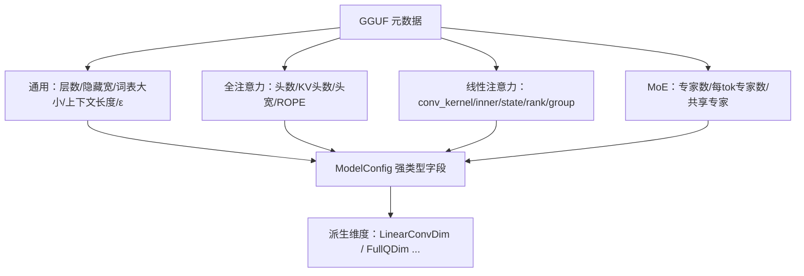

# 第 8 章 把文件变回模型：配置抽取与权重加载

> 面向初学者：本章把"一堆张量字节"变成"一台能前向的机器"。你会看到项目怎么读取模型的超参表、怎么按名字认出每一块权重、怎么分配缓存。每小节贴 `src/Qwen35Sharp.Model/` 的**真实源码**，配图。

前三阶段我们造的是"通用计算器"；从本章起，它变成"专属于 Qwen3.5 的机器"。三件事：把 GGUF 元数据翻译成超参表、按名字认领张量进统一结构、把缓存与内存按模型尺寸一次性备好。

## 8.1 一份超参表：ModelConfig 的诞生

模型的"身材"（有多少层、每层多宽、有几头注意力……）全部刻在 GGUF 元数据里。`src/Qwen35Sharp.Model/ModelConfig.cs` 的 `ModelConfig.FromGguf(GgufFile gguf)` 把它们翻译成强类型字段。

先把"认全模型身材"的流程画成图：



真实代码先看字段与派生维度（这是全书的"尺寸字典"）：

```csharp
public sealed class ModelConfig
{
    public string Architecture { get; init; } = "qwen35";   // qwen35 或 qwen35moe
    public int NumLayers { get; init; }      // 总层数
    public int HiddenSize { get; init; }     // 隐藏层宽度
    public int FfnSize { get; init; }        // FFN 宽度

    public int NumHeads { get; init; }       // 全注意力头数
    public int NumKvHeads { get; init; }     // GQA 的 KV 头数
    public int HeadDim { get; init; }        // 每头维度
    public int RopeDim { get; init; }        // RoPE 旋转维度（部分旋转）
    public float RopeBase { get; init; } = 10000f;

    public int SsmConvKernel { get; init; }  // 线性层卷积核大小（默认 4）
    public int SsmInnerSize { get; init; }   // 线性层内部宽度（== value 宽）
    public int SsmStateSize { get; init; }   // 状态矩阵的"头宽"（key head dim）
    public int SsmTimeStepRank { get; init; }// value 头数
    public int SsmGroupCount { get; init; }  // key 头数

    public bool IsMoe { get; init; }         // 是不是 MoE 变体
    public int NumExperts { get; init; }     // MoE 专家总数
    public int NumExpertsPerTok { get; init; } // 每 token 激活的专家数（top-k）
    public int MoeFfnSize { get; init; }     // 每个专家的 FFN 宽度
    // ... MoeShared* / ExpertWeightsScale ...

    public int VocabSize { get; set; }       // 词表大小
    public int ContextLength { get; init; }  // 上下文长度
    public float Eps { get; init; } = 1e-6f; // RMSNorm 的 ε
    public bool[] IsRecurrent { get; init; } = [];  // 每层类型：true=线性注意力

    // ---- 派生维度（算一次，收成一地，避免散落魔数）----
    public int LinearConvDim => 2 * SsmGroupCount * SsmStateSize + SsmInnerSize;  // qkv 拼接宽
    public int LinearKeyDim => SsmGroupCount * SsmStateSize;                      // k 宽
    public int LinearValueDim => SsmTimeStepRank * SsmStateSize;                  // v/门控/输出宽
    public int FullQDim => NumHeads * HeadDim;                                    // 全注意力 q 宽
    public int FullKvDim => NumKvHeads * HeadDim;                                 // 全注意力 k/v 宽
}
```

`FromGguf` 把每个键翻译成字段。为什么一大堆缺省值？因为 GGUF 的产生方五花八门，有些键在某个版本里就是缺的。哲学是"能容错则容错，缺省值永远挑安全那个"：

```csharp
public static ModelConfig FromGguf(GgufFile gguf)
{
    string arch = gguf.GetString("general.architecture", "qwen35");
    int hidden = (int)gguf.GetUint32($"{arch}.embedding_length");
    int heads = (int)gguf.GetUint32($"{arch}.attention.head_count");
    int kvHeads = (int)gguf.GetUint32($"{arch}.attention.head_count_kv", (uint)heads);
    int headDim = (int)gguf.GetUint32($"{arch}.attention.key_length", 0);
    if (headDim == 0) headDim = hidden / heads;              // 缺省按 hidden/heads 推
    int ropeDim = (int)gguf.GetUint32($"{arch}.rope.dimension_count", (uint)headDim);
    // ... 线性注意力、MoE、返回对象 ...
}
```

## 8.2 看张量决定层类型：比公式更可靠的判定

层类型怎么判定？最自然的是用公式 `(L+1) % full_attention_interval == 0`。但公式假设 checkpoint 严格遵守间隔——万一未来有个新 checkpoint 偷偷在某层换用了另一种混合器，公式就会判错。

项目采用的是"**看权重，不看公式**"：有 `attn_qkv` 张量就是线性层、有 `attn_q` 张量就是全注意力、都没有才退回公式。真实代码（第 2 章已见，这里补充 MoE 判定）：

```csharp
// 层类型判定核心
for (int i = 0; i < layers; i++)
{
    bool hasQkv = gguf.Tensors.ContainsKey($"blk.{i}.attn_qkv.weight");
    bool hasQ = gguf.Tensors.ContainsKey($"blk.{i}.attn_q.weight");
    if (hasQkv || hasQ)
    {
        isRecurrent[i] = hasQkv;      // 有 qkv → 线性层
        anyTensors = true;
    }
    else
    {
        isRecurrent[i] = (i + 1) % fullAttnInterval != 0;   // 兜底公式
    }
}
if (!anyTensors)   // 整个文件没有层张量（只有 header？）全部用公式
    for (int i = 0; i < layers; i++)
        isRecurrent[i] = (i + 1) % fullAttnInterval != 0;

// MoE 判定：看架构名
bool isMoe = string.Equals(arch, "qwen35moe", StringComparison.Ordinal);
int usedCount = (int)gguf.GetUint32($"{arch}.expert_used_count", isMoe ? 8u : 0u);
```

## 8.3 认领张量：union 式 Weight 与加载流程

`src/Qwen35Sharp.Model/Qwen35Model.cs` 里有个极有 C 风味的结构——**union 式 `Weight`**：同一块内存，按 `Type` 解释成不同格式的指针。这样模型层签名极简，一个 `Weight` 传进任何分派函数：

```csharp
private struct Weight
{
    public GgmlTensorType Type;              // 类型：决定下面的哪个指针有效
    public BlockQ4K* Q4;  public BlockQ4Kx8* Packed;  public BlockQ4Kx8Meta* Meta;
    public BlockQ5K* Q5;
    public BlockQ6K* Q6;  public BlockQ6Kx8* Packed6;
    public BlockQ2_0C* Q2; public BlockQ2x8* Packed2;
    public BlockSTQ1_0* STQ; public BlockSTQ1_0x8* PackedSTQ;
    public BlockIQ4XS* Q4xs;
    public float* F32;
    public int NIn, NOut;
    public int NExpert; public long ExpertStride;   // 3D MoE 专家张量的字节步长
    public int Count;                               // F32 元素数
}
```

`LoadWeights`（`Qwen35Model.cs`）遍历 `_gguf.Tensors`。F32 小张量直接拷贝；量化张量按形状算块数与每块字节，整段拷进 `NativeBuffer`，符合条件再追加面板与 meta（真实代码结构）：

```csharp
private void LoadWeights()
{
    foreach ((string name, GgufTensorInfo info) in _gguf.Tensors)
    {
        byte* data = _gguf.DataBase + (long)info.Offset;
        if (info.Type == GgmlTensorType.F32)
        {
            int n = checked((int)info.NumElements);
            NativeBuffer buf = Rent((nuint)((long)n * sizeof(float)));
            Buffer.MemoryCopy(data, buf.Pointer, buf.Bytes, buf.Bytes);
            _weights[name] = new Weight { Type = F32, F32 = (float*)buf.Pointer, Count = n };
            continue;
        }
        int nIn = (int)info.Shape[0];              // 最内层 = 行长 = nIn
        int nOut = info.Shape.Length > 1 ? (int)info.Shape[1] : 1;
        int nExpert = info.Shape.Length > 2 ? (int)info.Shape[2] : 1;
        if (nIn % Qk.SuperBlock != 0)
            throw new NotSupportedException($"{name}: nIn={nIn} is not a multiple of 256");
        int nb = info.Type switch { Q2_0C => nIn / Q2_0C.BlockLength,
                                    STQ1_0 => nIn / STQ1_0.BlockLength, _ => nIn / Qk.SuperBlock };
        int blockBytes = /* ... per-type block size ... */;
        NativeBuffer quant = Rent((nuint)((long)nOut * nExpert * nb * blockBytes));
        Buffer.MemoryCopy(data, quant.Pointer, quant.Bytes, quant.Bytes);
        Weight w = new() { Type = info.Type, NIn = nIn, NOut = nOut, NExpert = nExpert,
                           ExpertStride = (long)nOut * nb * blockBytes };
        // 满足 nOut>=8 && nExpert==1 时，追加 RepackQ4K.Rows+BuildMeta / RepackQ6K / RepackQ2 / RepackSTQ
        _weights[name] = w;
    }
}
```

**`token_embd.weight` 特例**：只要求 `nIn` 是 256 的倍数，按行反量化进隐藏态（embedding 是查表不是矩阵乘，不走面板）。

## 8.4 缓存与状态：出生时就把内存备好

模型还需要"会成长的状态"。三块内存都在构造函数里一次性备好。

### 全注意力 KV 缓存

只给 `IsRecurrent == false` 的层分配：`_cacheK[l]`/`_cacheV[l]`，容量 `= min(ContextLength, 4096)`，行距 `FullKvDim`。`EnsureCache` 按需倍增扩容（真实代码 `Qwen35Model.cs`）：

```csharp
private void EnsureCache(int needed)
{
    if (needed <= _cacheCap) return;                 // 够用就算了
    int next = Math.Max(needed, _cacheCap * 2);      // 倍增
    next = Math.Min(next, Config.ContextLength);     // 封顶
    int kvStride = Config.FullKvDim;
    // 逐层：Rent 新 K/V → Buffer.MemoryCopy 拷旧 → 原子替换 → 释放旧缓冲
    // 中途异常回滚：Dispose 已 Rent 但未替换的缓冲
    _cacheCap = next;
}
```

为什么"倍增 + 封顶"而不是一次到位？因为小 session 不需要 4096 的容量，倍增让复制成本摊平，封顶防止无限扩张。

### 线性注意力状态

线性层不要 KV 缓存，要两块**固定大小**的状态（与序列长度无关，这是线性注意力的承诺）：

```csharp
// _linState[l]: [nHeads=timeStepRank][keyHeadDim=stateSize][valueHeadDim=stateSize]
// _linConv[l]:  [stateLen = convKernel-1][convDim]  滚动卷积窗口
long stateBytes = (long)linHeads * linHeadDim * linVHeadDim * sizeof(float);
int stateLen = Math.Max(1, Config.SsmConvKernel - 1);
long convBytes = (long)stateLen * Config.LinearConvDim * sizeof(float);
NativeBuffer sb = Rent((nuint)((long)Config.NumLayers * stateBytes));
NativeBuffer cb = Rent((nuint)((long)Config.NumLayers * convBytes));
for (int l = 0; l < Config.NumLayers; l++)
{
    _linState[l] = (float*)((byte*)sb.Pointer + (long)l * stateBytes);
    _linConv[l]  = (float*)((byte*)cb.Pointer + (long)l * convBytes);
}
```

### 模型级 scratch 与 Bump

`EnsureScratch(seq, kvLen)` 估算最坏单层占用 + 4MB 余量；`Bump(bytes)` 64B 对齐切、`_scratchUsed` 每层开头回卷到 `layerMark`；越界抛 `InsufficientMemoryException`（真实代码）：

```csharp
private void* Bump(nuint bytes)
{
    if (_scratch == null) _scratch = Rent(64 * 1024 * 1024);
    int aligned = (int)((bytes + 63) & ~(nuint)63);      // 64B 对齐
    if (_scratchUsed + aligned > (int)_scratch.Bytes)
        throw new InsufficientMemoryException(
            $"Scratch arena overflow: need {_scratchUsed + aligned} of {_scratch.Bytes} bytes. " +
            "Recompute EnsureScratch sizing for this model.");
    byte* ptr = (byte*)_scratch.Pointer + _scratchUsed;
    _scratchUsed += aligned;
    return ptr;
}
```

`EnsureScratch` 里的估算把线性层内部、全注意力内部、MoE 内部、FFN 分别算好再相加——保证一次 `Forward` 内不重增长（指针稳定）。

> **一句话总结这一章**：`ModelConfig.FromGguf` 把超参抽成强类型字段与派生维度，用"看张量认层型"代替脆弱公式；`Qwen35Model.LoadWeights` 用 union 式 `Weight` 认领所有权重进 `NativeBuffer` 并按需重打包面板；`EnsureCache`/`EnsureScratch`/`Bump` 把 KV、线性状态与 scratch 在构造时各就各位。零件齐了，但还没点火——第 9 章，`Forward` 主循环带着一切开跑。