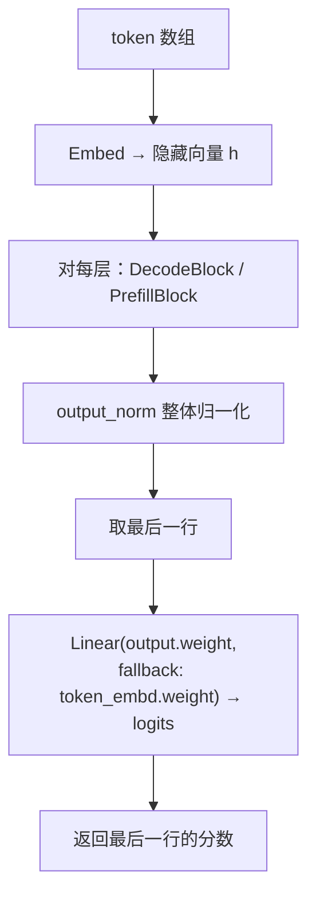

# 第 9 章 前向骨架：一次 Forward 的发动机

> 面向初学者：本章把前面所有零件"点火"——写 `Forward` 主循环：输入一段 token，输出最后一行的分数（logits），沿途更新所有缓存与状态。每小节贴 `src/Qwen35Sharp.Model/` 的**真实源码**，配图。

第 8 章我们把机器组装好了。这一章**点火**——写完 `Forward` 主循环。它是发动机：一次调用，输入一段 token，输出最后一行的 logits，沿途更新所有缓存与状态。

这一章的走法：我们**首先**写 `Forward` 主循环，把 token 变成 logits（9.1 节）；**其次**看中转站上的一堆分派函数——`Linear`、`DecodeLinear`、`GemvPrequant`、`F32Gemm`（9.2 节）；**接着**认识逐点算子全家桶（9.3 节）；**然后**走进 `DecodeBlock` 与 `PrefillBlock`，看单层的统一画布（9.4 节）；**最后**一起庆祝第一次"能跑"的里程碑，然后看向两个真正的 token 混合器（9.5 节）。

## 9.1 Forward 主循环：把 token 变成 logits

`src/Qwen35Sharp.Model/Qwen35Model.cs` 的 `Forward(int[] tokens)` 是模型层的公共入口（真实代码，一步步注释）：

```csharp
public float[] Forward(int[] tokens)
{
    _scratchUsed = 0;                       // 本轮的 scratch 起点
    int seq = tokens.Length;                // 这次处理几个 token
    int start = _cacheLen;                  // KV 缓存"写到哪"的起点
    EnsureCache(start + seq);               // KV 不够就倍增扩容
    EnsureScratch(seq, start + seq);        // 按本次实际尺寸整备临时内存
    int hidden = Config.HiddenSize;
    float* h = (float*)Bump((nuint)((long)seq * hidden * sizeof(float)));
    Embed(tokens, h);                       // ① token 编号 → 隐藏向量
    int layerMark = _scratchUsed;

    if (seq == 1)
    {
        // decode：一次只处理 1 个 token，逐层走 DecodeBlock
        for (int layer = 0; layer < Config.NumLayers; layer++)
        {
            _scratchUsed = layerMark;       // 每层回到层起点，复用同一块 scratch
            DecodeBlock(h, layer, start);
        }
    }
    else
    {
        // prefill：一次处理整段提示词，逐层走 PrefillBlock
        for (int layer = 0; layer < Config.NumLayers; layer++)
        {
            _scratchUsed = layerMark;
            PrefillBlock(h, layer, seq, start);
            // Q35_DIAG=1 时每 3 层打印隐藏态范数，用于定位数值发散
            if (Environment.GetEnvironmentVariable("Q35_DIAG") == "1" && layer % 3 == 2)
            {
                float n2 = 0; float* lastTok = h + (long)(seq - 1) * hidden;
                for (int i = 0; i < hidden; i++) n2 += lastTok[i] * lastTok[i];
                Console.Error.WriteLine($"[diag] prefill after L{layer}: |h_last|={MathF.Sqrt(n2 / hidden):F3}");
            }
        }
    }

    float* normed = (float*)Bump((nuint)((long)seq * hidden * sizeof(float)));
    Rms("output_norm.weight", h, normed, seq, hidden);   // ② 最后一层后整体归一化
    float* last = normed + (seq - 1) * hidden;           // 取最后一个 token 那行
    int vocab = Config.VocabSize > 0 ? Config.VocabSize : Tokenizer.VocabSize;
    float[] logits = new float[vocab];
    fixed (float* lp = logits)
        Linear(last, "output.weight", lp, hidden, vocab, 1, fallback: "token_embd.weight");   // ③ LM head

    _cacheLen += seq;                        // 记忆水位推进
    _cacheTokens.AddRange(tokens);
    Debug.Assert(_cacheTokens.Count == _cacheLen);
    return logits;                           // 返回最后一个 token 的分数
}
```

用一张图看这个循环在做什么：



关键设计：

- **`start` 贯穿全局**：所有层从 `start` 起写 KV/状态，多轮对话旧缓存不被覆盖。
- **一次 `Forward` 处理一段，`seq==1` 就是 decode**：同一个函数，喂的 token 数不同。
- **`layerMark` 回卷**：每层开头 `_scratchUsed = layerMark`，各层复用同一段 scratch。
- **logits 只有最后一行**：自回归只需要最后一个生成字的分类分数。`fallback: "token_embd.weight"` 让输出头与输入 embedding 共享权重时直接复用，省一块巨大拷贝。

## 9.2 分派中转：Linear / DecodeLinear / GemvPrequant / F32Gemm

`src/Qwen35Sharp.Model/Qwen35Model.Decode.cs`（`public sealed unsafe partial class Qwen35Model`）是解码侧的中转站。**`Linear`** 按 `w.Type` 分派到第 5、6 章的内核（第 6 章已示完整 switch）；**`DecodeLinear`** 是单 token 兄弟，走 `*Gemv`。

**`GemvPrequant`**——接受**已量好的 Q8 行**，不做量化只做点积。模型层用它在 FFN/注意力里"一次量化、多次点积"：

```csharp
private void GemvPrequant(Weight w, BlockQ8K* x, float* y, int nIn, int nOut)
{
    switch (w.Type)
    {
        case GgmlTensorType.Q2_0C:   MulMatQ2.GemvPrequant(w.Packed2, w.Q2, x, y, nIn, nOut, _pool); break;
        case GgmlTensorType.STQ1_0:  MulMatSTQ.GemvPrequant(w.PackedSTQ, w.STQ, x, y, nIn, nOut, _pool); break;
        case GgmlTensorType.IQ4_XS:  IQ4XS.GemvPrequant(w.Q4xs, x, y, nIn, nOut, _pool); break;
        case GgmlTensorType.Q5_K:    Q5K.GemvPrequant(w.Q5, x, y, nIn, nOut, _pool); break;
        case GgmlTensorType.Q6_K:    Q6K.GemvPrequant(w.Q6, x, y, nIn, nOut, _pool); break;
        default:                     MulMatQ4K.GemvPrequant(w.Q4, x, y, nIn, nOut, _pool); break;
    }
}
```

**`F32Gemm`** 用 `Ops.DotF32` 逐 token 逐行算 `y = x·Wᵀ`（router/共享门控等小张量不值得造量化内核）：

```csharp
private void F32Gemm(float* w, float* input, float* output, int nIn, int nOut, int tokens)
{
    for (int t = 0; t < tokens; t++)
    {
        float* x = input + (long)t * nIn;
        float* y = output + (long)t * nOut;
        for (int o = 0; o < nOut; o++)
            y[o] = Ops.DotF32(x, w + (long)o * nIn, nIn);   // 第 o 行权重与 x 点积
    }
}
```

**`Rms`/`RmsSerial`** 封装 `Qwen35Ops.RmsNormZeroCentered`；大矩阵并行、小矩阵串行省派发。**`Embed`** 按 `token_embd.weight` 类型反量化、`tokens>8` 并行。

## 9.3 逐点算子全家桶

矩阵乘之外，前向还有大半工作在逐点/规约算子，集中在 `Qwen35Ops.cs` 与 `Ops.cs`。第 2 章已贴 `RmsNormZeroCentered` 与 `GatedRmsNorm`；这里补充 `Ops.cs` 里 softmax 因果版的关键（真实代码）：

```csharp
public static void SoftmaxCausal(float* scores, int heads, int qLen, int kvLen,
    int startPos, CpuThreadPool? pool = null)
{
    void Body(int worker, int workers)
    {
        for (int h = begin; h < end; h++)
            for (int q = 0; q < qLen; q++)
            {
                float* row = scores + (h * qLen + q) * kvLen;
                int allowed = Math.Min(kvLen, startPos + q + 1);   // 因果：只看自己及之前
                SoftmaxRow(row, allowed);                           // 对可见前缀归一
                FillZero(row + allowed, kvLen - allowed);           // 尾部精确写 0
            }
    }
    if (pool == null || heads <= 1) Body(0, 1);
    else pool.For(heads, Body);
}
```

`SoftmaxRow` 内部用 `FastExp.ExpAvx2`、被减量 floor 到 `-80`（防下溢污染归一）。`NeoXRoPE` 的 cos/sin 表、`DotF32`/`AxpyF32`/`SiLUMul`/`AddInPlace` 都在同一文件；`SiLUMul` 的 AVX2 路径调 `FastExp.SiluAvx2`。

## 9.4 DecodeBlock 与 PrefillBlock：单层的统一画布

`DecodeBlock`（`Qwen35Model.Decode.cs`）把第 2 章的"统一层结构"变成代码（真实实现，逐行走）：

```csharp
private void DecodeBlock(float* hidden, int layer, int start)
{
    const int seq = 1;
    int hiddenSize = Config.HiddenSize;
    float* n1 = (float*)Bump((nuint)hiddenSize * sizeof(float));
    float* attn = (float*)Bump((nuint)hiddenSize * sizeof(float));
    RmsSerial($"blk.{layer}.attn_norm.weight", hidden, n1, seq, hiddenSize);   // ① 层输入 norm

    if (Config.IsRecurrent[layer]) DecodeLinearAttn(n1, attn, layer, start);   // ② 线性注意力
    else                           DecodeAttention(n1, attn, layer, start);    //    或全注意力
    Ops.AddInPlace(hidden, attn, hiddenSize, pool: null);                      // ③ 残差 1

    float* n2 = (float*)Bump((nuint)hiddenSize * sizeof(float));
    RmsSerial($"blk.{layer}.post_attention_norm.weight", hidden, n2, seq, hiddenSize);  // ④
    if (Config.IsMoe)
    {
        float* moe = (float*)Bump((nuint)hiddenSize * sizeof(float));
        DecodeSparseMoe(n2, moe, layer);                          // ⑤a MoE FFN
        Ops.AddInPlace(hidden, moe, hiddenSize, pool: null);      // ⑥ 残差 2
    }
    else
    {
        // ⑤b dense FFN：gate/up 一次量化两投鞭，down 融合 SiLU
        float* gate = Bump(Config.FfnSize * sizeof(float));
        float* up = Bump(Config.FfnSize * sizeof(float));
        float* down = Bump(hiddenSize * sizeof(float));
        DecodeGateUp(n2, gate, up, layer);
        Ops.SiLUMul(gate, up, Config.FfnSize, pool: null);
        DecodeLinear(gate, $"blk.{layer}.ffn_down.weight", down, Config.FfnSize, hiddenSize);
        Ops.AddInPlace(hidden, down, hiddenSize, pool: null);     // ⑥
    }
}
```

`DecodeGateUp`——**一次量化、两投鞭**（第 5 章"处处复用"的模型层兑现）：

```csharp
private void DecodeGateUp(float* input, float* gate, float* up, int layer)
{
    Weight wg = _weights[$"blk.{layer}.ffn_gate.weight"];
    Weight wu = _weights[$"blk.{layer}.ffn_up.weight"];
    int hidden = Config.HiddenSize; int ffn = Config.FfnSize;
    nuint q8Bytes = (nuint)Q8K.RowBytes(hidden);
    BlockQ8K* y = (BlockQ8K*)_gemmScratch.D(q8Bytes);
    Q8K.QuantizeRow(input, y, hidden);       // 一次量化
    GemvPrequant(wg, y, gate, hidden, ffn);  // gate 点积
    GemvPrequant(wu, y, up, hidden, ffn);    // up 点积
}
```

`PrefillBlock`（`Qwen35Model.Prefill.cs`）与之镜像，但用 `Rms`/`PrefillGateUp` 批处理版，且 `ffn_down` 走 `Linear`（GEMM）。两版本里都有 `Q35_TRACE` 的 `T(...)` 留痕（"attn_norm ok"、"token-mixer ok"……），方便诊断每步是否执行。

## 9.5 第一次"能跑"的里程碑

到这里 `Forward` 把一切串起来了：

- 输入一段 token，得到**真实模型**的 logits——不是随机数；
- KV 缓存与线性状态在每次 `Forward` 后正确更新；
- 同样的代码，`seq==1` 是 decode、`seq>1` 是 prefill。

但两个最重要的 token 混合器——全注意力与 Gated-DeltaNet——仍是两个分支名。模型的**灵魂**在接下来三章。第 10 章，全注意力层。

> **一句话总结这一章**：`Forward` 用 `start` 锚定记忆水线、`layerMark` 回卷 scratch、`seq==1` 判别 decode/prefill；`Linear`/`DecodeLinear`/`GemvPrequant`/`F32Gemm` 把模型语义翻译成内核调用；`DecodeBlock`/`PrefillBlock` 加 `DecodeGateUp` 一次量化两投鞭。往画布上填第一块真正的肉：**全注意力层**。