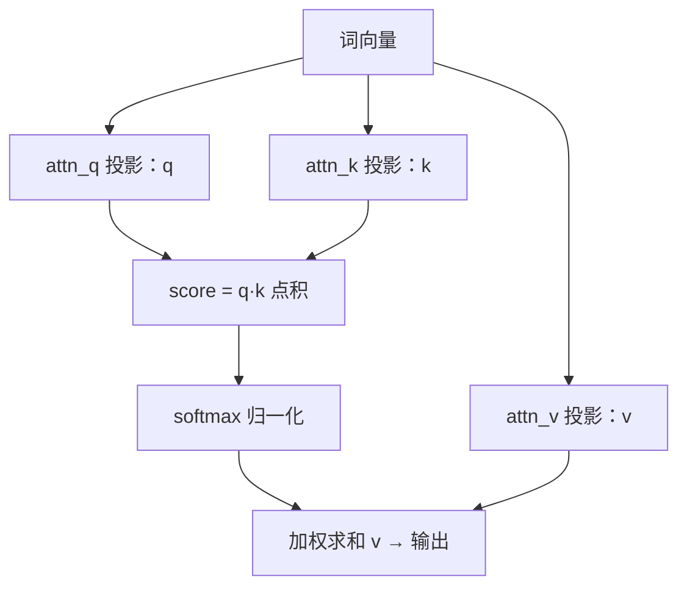

# 第 10 章 全注意力层：标准 GQA 的落地

> 面向初学者：本章实现 Transformer 里最经典的"注意力机制"。我们会先讲清楚它的直觉，再看 Qwen3.5 加的三个"变奏"，最后逐段看 `src/Qwen35Sharp.Model/` 的**真实源码**，配图。

第 9 章的画布上，第一个被填满的 token 混合器是全注意力层。它是"最像教科书"的部分——**让句子里的每个词都能参考所有其他词**——但 Qwen3.5 给它加了三个不平凡的变奏：**两倍宽查询投影、sigmoid 门控、per-head RMSNorm**。

## 10.1 投影与 q|gate 解交错

先看注意力是怎么"算"的。每个词的向量会同时变成三样东西（用三个不同的线性投影）：

- **q（查询）**：代表"我在找什么"；
- **k（键）**：代表"我提供什么关键字"；
- **v（值）**：代表"我实际给的答案内容"。

注意力打分的过程，就是让"我的查询 q"和"所有词的键 k"逐个做点积——点积越大说明越相关，再经 softmax 变成权重，最后按权重加权求和所有的值 v。



Qwen3.5 的第一个变奏：**`attn_q.weight` 的输出宽度是 `2·qDim`**。多出的那一半是"门控"（gate）。两个东西按头交错地放在一起：

```
[ q_h0, gate_h0, q_h1, gate_h1, q_h2, gate_h2, … ]
```

GEMM 跑完后，要把这条交错流**按头解交错**成独立的 `q` 与 `gate`（真实代码，`src/Qwen35Sharp.Model/Qwen35Model.Prefill.cs`）：

```csharp
// Q + gate: GEMM output qGateBuf is [seq][2*qDim]; feature dim is interleaved
// per-head as [q_h0, gate_h0, q_h1, gate_h1, ...].
float* qGateBuf = (float*)Bump((nuint)((long)seq * 2 * qDim * sizeof(float)));
Linear(input, $"blk.{layer}.attn_q.weight", qGateBuf, hidden, 2 * qDim, seq);

// Unpack the interleaved q|gate into head-major [seq][heads][dim].
for (int t = 0; t < seq; t++)
{
    float* row = qGateBuf + (long)t * 2 * qDim;
    float* qRow = q + (long)t * qDim;
    float* gRow = gate + (long)t * qDim;
    for (int h = 0; h < heads; h++)
    {
        int baseOff = h * 2 * dim;              // 第 h 个头的起点
        for (int d = 0; d < dim; d++)
        {
            qRow[h * dim + d] = row[baseOff + d];           // 取 q
            gRow[h * dim + d] = row[baseOff + dim + d];     // 取 gate（偏移半段）
        }
    }
}
// k/v 直接写进 KV 缓存：_cacheK[layer] + start*kDim / _cacheV[layer] + start*kDim
Linear(input, $"blk.{layer}.attn_k.weight", k, hidden, kDim, seq);
Linear(input, $"blk.{layer}.attn_v.weight", v, hidden, kDim, seq);
```

注意 `k`/`v` 的 GEMM 结果**直接写进 KV 缓存** `start..start+seq`——不需要中间缓冲。`_cacheK[layer] + start * kDim` 就是这个写段。

## 10.2 RoPE 与 per-head RMSNorm

Q 与 K 在打分前要做两件事：**部分 RoPE 旋转**（加位置信息）和**每头单独 RMSNorm**（稳定分数）。真实代码（`Qwen35Model.Prefill.cs`）：

```csharp
Ops.NeoXRoPE(q, seq, heads, dim, Config.RopeDim, start, Config.RopeBase, _pool);
Ops.NeoXRoPE(k, seq, kvHeads, dim, Config.RopeDim, start, Config.RopeBase, _pool);
// per-head RMSNorm：把 [seq][heads][dim] 拍扁成 [seq*heads][dim] 的行矩阵做 norm
Rms($"blk.{layer}.attn_q_norm.weight", q, q, seq * heads, dim);
Rms($"blk.{layer}.attn_k_norm.weight", k, k, seq * kvHeads, dim);
```

`Ops.NeoXRoPE` 的真实实现（`src/Qwen35Sharp.Model/Ops.cs`）——cos/sin 查找表 + 逐行旋转：

```csharp
public static void NeoXRoPE(float* x, int tokens, int heads, int headDim,
    int ropeDim, int startPos, float baseFreq, CpuThreadPool? pool = null)
{
    int half = ropeDim / 2;                                  // 只旋转一半维度（成对）
    EnsureRopeTable(startPos + tokens, half, baseFreq);      // 建 cos/sin 表（按 pos 缓存）
    float[] cos = RopeCos!; float[] sin = RopeSin!;
    int rows = tokens * heads;
    // 并行或串行逐行旋转（i < half 的维旋转，其余 pass-through）
    if (pool == null || rows <= 16) RopeRange(...);
    else pool.For(rows, (worker, workers) => { ... });
}
```

`EnsureRopeTable` 按 `freq_i = base^(-i/half)` 预算整个 cos/sin 查找表、按 pos 缓存、容量 ≥4096 自动增长——这样 decode 时不必每个 token 重算三角函数。

## 10.3 评分·softmax·加权：注意力三段式

三个 `Ops` 函数分别负责评分、softmax、加权（第 9 章讲过一个，这里形成完整画面）。

**评分 `Ops.AttentionScores`**——GQA（Grouped-Query Attention，即多个 q 头共享一个 kv 头，省显存）映射 `kvh = h/group`，并用 `Dot2x4`/`DotF32x4` 批量算，减少 K 的重复加载：

```csharp
int group = heads / kvHeads;
// 对每个头 h：kvh = h/group；对每个 qt：
//   对可见 [0, allowed)：score[qt,pos] = dot(q[qt,h], k[pos,kvh]) * scale
for (; qt + 1 < qLen; qt += 2)                  // 两行 q 共享 K load
{
    float* q0 = q + qt * qDim + h * headDim;
    float* q1 = q0 + qDim;
    int allowed = Math.Min(kvLen, startPos + qt + 2);
    for (int kt = 0; kt + 3 < allowed; kt += 4)
        Dot2x4(q0, q1, kBase + kt * kvStride, kvStride, headDim,
               row0 + kt, row1 + kt, scale);    // 2 q × 4 k 一批
}
```

**因果 softmax `Ops.SoftmaxCausal`**（第 9 章贴过）：只归一可见前缀、尾部精确写 0、被减量 floor 到 -80。

**加权 `Ops.AttentionCombine`**——用 `Axpy64` 让 64 个输出维驻留寄存器，v 只流一遍：

```csharp
public static void AttentionCombine(
    float* cacheV, float* scores, float* output,
    int heads, int kvHeads, int headDim, int qLen, int kvLen,
    int qDim, int kvStride, int startPos, CpuThreadPool? pool = null)
{
    int group = heads / kvHeads;
    void Body(int worker, int workers)
    {
        for (int h = begin; h < end; h++)
        {
            int kvh = h / group;
            float* vBase = cacheV + kvh * headDim;
            for (int qt = 0; qt < qLen; qt++)
            {
                float* row = scores + (h * qLen + qt) * kvLen;
                float* outH = output + qt * qDim + h * headDim;
                int allowed = Math.Min(kvLen, startPos + qt + 1);
                int d = 0;
                if (Avx.IsSupported && Fma.IsSupported)
                    for (; d + 63 < headDim; d += 64)
                        Axpy64(row, vBase + d, kvStride, allowed, outH + d);   // 64 维驻留寄存器
                if (d < headDim) { /* 尾部用 AxpyF32 */ }
            }
        }
    }
    if (pool == null || heads <= 1) Body(0, 1); else pool.For(heads, Body);
}
```

## 10.4 sigmoid 门控与输出投影

Qwen3.5 相对 Qwen2/3 的核心改动，实现不过几行。decode 版（`Qwen35Model.Decode.cs`）：

```csharp
// Apply attention gate: out = out * sigmoid(gate).
// 大白话：算完注意力后，再按"门控"逐元素决定消息可不可信，不信就按比例衰减。
for (int i = 0; i < qDim; i++)
    ao[i] *= 1f / (1f + MathF.Exp(-gate[i]));
DecodeLinear(ao, $"blk.{layer}.attn_output.weight", output, qDim, Config.HiddenSize);
```

prefill 版（`Qwen35Model.Prefill.cs`）是整段做：

```csharp
int total = seq * qDim;
for (int i = 0; i < total; i++)
    ao[i] *= 1f / (1f + MathF.Exp(-gate[i]));
Linear(ao, $"blk.{layer}.attn_output.weight", output, qDim, hidden, seq);
```

**为什么按头交错**？一次 load 能同时取到该头的 q 与 gate，cache 友好；解交错是纯内存变换。

## 10.5 KV 缓存的写入与前缀复用

**写入**：`DecodeAttention`/`PrefillAttention` 的 k/v 直接落 `_cacheK[l]`/`_cacheV[l]` 的 `start..start+seq`（`EnsureCache` 保证空间，见 8.4）。

**复用**：`src/Qwen35Sharp.Model/KvCacheAlign.cs` 找公共前缀（真实代码，带注释）：

```csharp
public static class KvCacheAlign
{
    public static int CommonPrefixLength(ReadOnlySpan<int> cached, ReadOnlySpan<int> prompt)
    {
        int n = Math.Min(cached.Length, prompt.Length);
        int i = 0;
        while (i < n && cached[i] == prompt[i]) i++;   // 数公共的 token
        return i;
    }

    public static PromptReuse Plan(ReadOnlySpan<int> cached, ReadOnlySpan<int> prompt)
    {
        if (prompt.Length == 0) return new PromptReuse(0, 0);
        int common = CommonPrefixLength(cached, prompt);
        if (common == prompt.Length)                    // 全命中：整个提示已缓存
            return new PromptReuse(prompt.Length - 1, prompt.Length - 1);   // 重放最后 token 刷新 logits
        return new PromptReuse(common, common);         // 分歧 tail：截断到公共前缀
    }
}
public readonly record struct PromptAlignment(int Cached, int[] Suffix);
public readonly record struct PromptReuse(int TruncateTo, int SuffixStart);
```

`Qwen35Model.AlignPrompt` 据此 `TruncateCache(plan.TruncateTo)` 并给出 `Suffix`：

```csharp
public PromptAlignment AlignPrompt(ReadOnlySpan<int> promptIds)
{
    PromptReuse plan = KvCacheAlign.Plan(CollectionsMarshal.AsSpan(_cacheTokens), promptIds);
    TruncateCache(plan.TruncateTo);
    return new PromptAlignment(plan.TruncateTo, promptIds[plan.SuffixStart..].ToArray());
}
```

**一个诚实的陷阱**：截断只回滚全注意力的 KV 缓存；线性状态 S 与卷积窗口在截断时不回滚（第 11 章）。当前约定"对话内缓存只增，要回退重写就 `/reset` 全清"。五个 `KvCacheAlignTests` 用例（分歧 tail 保留前缀/缓存长于提示不丢前缀/全命中重放/空缓存整段/无重叠重置）把这套行为锁死。

> **一句话总结这一章**：全注意力层把最教科书式的注意力落到自己的内核上，守住三个变奏——两倍宽 q 投影（`PrefillAttention`/`DecodeAttention` 解交错）、per-head RMSNorm（`Rms` 拍扁成行 norm）、sigmoid 门控（`1/(1+exp(-gate))`）；KV 写入与 `KvCacheAlign.Plan` 前缀复用让它参与多轮对话。但真正的硬骨头是下一章——那个"读—改—写"记忆矩阵的 Gated-DeltaNet 线性注意力。