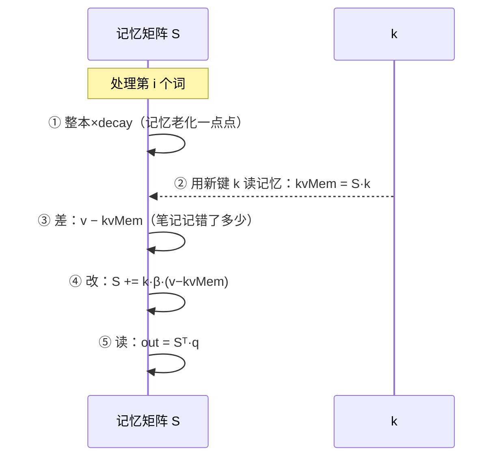

# 第 11 章 Gated-DeltaNet：线性注意力的心脏

> 面向初学者：本章实现 Qwen3.5 的"另一种注意力"——Gated-DeltaNet。它用一个固定大小的小本子记忆整句历史，每读一个词就更新一次。我们用比喻 + 图 + **真实源码**（`GatedDeltaNetOps.cs`）把它彻底讲透。

终于来到全书最重要的一章。全注意力是"我都懂"，Gated-DeltaNet 是"读—改—写一个记忆矩阵"。它是 Qwen3.5 混入线性注意力的理由，也是本项目最独特的数学投资。

## 11.1 从直觉到算式：为什么它叫 delta-rule

先讲一个比喻。假设你有本**固定大小的笔记本** `S`：每个头一页，页上是一个矩阵——行是"键的分量"，列是"值的分量"。它就是你的全部历史记忆（被压缩成一页）。

每读一个新词（它带来 q、k、v、β、g 五个量），你依次做五件事：



- **① 衰减**：乘 `decay = e^g`（g≤0，所以 decay≤1）。旧记忆整体淡一点——回忆随时间褪色。
- **② 读**：用新键 k̂ 问笔记"过去记了什么"→ `kvMem = S·k̂`。
- **③ 差**：拿真实的 v 减记忆给的 `kvMem`→ 残差 `v − kvMem`（"笔记记错了多少"）。
- **④ 改**：`S += k̂·(β·(v−kvMem))`。β 是"这次修正信多少"。
- **⑤ 读**：用查询 q̂ 从"已更新"的 S 读出输出 `out = Sᵀ·q̂`。

这套"读—改—写"叫 **delta rule**（增量规则）——每次更新的是"修正已有记忆"，不是"再存一份"。

为什么比全注意力便宜？因为 `S` 大小固定（`[keyDim][valueDim]`），与句子长度无关；全注意力则要把全部历史存下来、每次从头比对。

实处落进 `src/Qwen35Sharp.Model/GatedDeltaNetOps.cs` 的 `public static unsafe class GatedDeltaNetOps`。它的头注释把张量布局讲得清清楚楚：

```csharp
/// <summary>
/// Ops specific to the Gated-DeltaNet linear-attention block: depthwise causal
/// conv1d (SiLU), and the recurrent delta-rule step.
///
/// These ops work on row-major float arrays matching the llama.cpp tensor
/// layouts used in llm_build_qwen35::build_layer_attn_linear:
///
///   q/i,k,v:  [token, head, dim]
///   g/beta:   [token, head]
///   state:    [head, headDim, vHeadDim]
/// </summary>
public static unsafe class GatedDeltaNetOps
{
```

记住这个布局约定（每个量在第几维），读实现时就不迷路。

## 11.2 投影张量与维度小宇宙

回顾 `ModelConfig` 的派生维度（第 8 章）：

```csharp
public int LinearKeyDim   => SsmGroupCount * SsmStateSize;      // k 的宽度 = key 头数 × 头宽
public int LinearValueDim => SsmTimeStepRank * SsmStateSize;    // v / z / out 的宽度
public int LinearConvDim  => 2*SsmGroupCount*SsmStateSize + SsmInnerSize; // qkv 三拼宽
```

九个投影是 `attn_qkv`/`attn_gate`/`ssm_conv1d`/`ssm_beta`/`ssm_alpha`/`ssm_a`/`ssm_dt.bias`/`ssm_norm`/`ssm_out`，在 `PrefillLinearAttn`/`DecodeLinearAttn` 里逐块消费。decode 版开头（真实代码，`Qwen35Model.Decode.cs`）：

```csharp
private void DecodeLinearAttn(float* input, float* output, int layer, int start)
{
    int nHeads = Config.SsmTimeStepRank;     // value 头数（也是状态头数）
    int headDim = Config.SsmStateSize;
    int keyDim = Config.LinearKeyDim;
    int valueDim = Config.LinearValueDim;
    int convDim = Config.LinearConvDim;

    // ① 投影们
    float* qkv = (float*)Bump((nuint)convDim * sizeof(float));
    DecodeLinear(input, $"blk.{layer}.attn_qkv.weight", qkv, hidden, convDim);
    float* z = (float*)Bump((nuint)valueDim * sizeof(float));
    DecodeLinear(input, $"blk.{layer}.attn_gate.weight", z, hidden, valueDim);
    // ...ssm_beta / ssm_alpha 同理...
```

两个必防陷阱：**`ssm_a` 已烘烤成 `−exp(A)`**（不再 exp）；**`SsmInnerSize` 兼作 value 宽**（命名与现实的错位）。

## 11.3 因果深度卷积：卷积状态与滚动窗口

投影完，qkv 先过一层**因果深度卷积**（depthwise causal conv1d）：每个通道独立做一维卷积、只看过去、输出过 SiLU。

### prefill 版 `CausalConv1d`（`GatedDeltaNetOps.cs`）

```csharp
/// <summary>Causal depthwise conv1d with SiLU. Prefill variant.
/// input: [channels][seq]; kernel: [kernelSize][channels].
/// Left-pads by kernelSize - 1. No bias.</summary>
[MethodImpl(MethodImplOptions.AggressiveOptimization)]
public static void CausalConv1d(
    float* input, float* kernel, int kernelSize, int channels, int seq, float* out_)
{
    for (int c = 0; c < channels; c++)                  // 每个通道独立处理
    {
        float* inCh = input + (long)c * seq;
        float* kCh = kernel + c;
        for (int t = 0; t < seq; t++)
        {
            float acc = 0f;
            for (int j = 0; j < kernelSize; j++)
            {
                int prev = t - j;
                if (prev < 0) continue;                 // 因果：t 时刻看不到未来
                acc += kCh[(long)j * channels] * inCh[prev];
            }
            outCh[t] = Silu(acc);                        // 输出过 SiLU
        }
    }
}
```

prefill 里调用前要把 `[seq][convDim]` 转置成 `[channels][seq]`，跑完再把最后 `stateLen` 个原始输入写回 `_linConv[l]`（为 decode 续命）：

```csharp
int stateLen = Math.Max(1, Config.SsmConvKernel - 1);
for (int c = 0; c < convDim; c++)
{
    float* cs = _linConv[layer] + (long)c * stateLen;
    int tailStart = Math.Max(0, seq - stateLen);
    for (int j = 0; j < stateLen; j++)
        cs[j] = qkvCh[(long)c * seq + tailStart + j];   // 保留最后 stateLen 个"原始输入"
}
```

### decode 版 `CausalConv1dUpdate`（滚动窗口单步）

```csharp
/// <summary>Single-token causal conv1d update. convState holds the last
/// kernelSize-1 input values per channel ([channels][stateLen], index 0 = oldest).</summary>
public static void CausalConv1dUpdate(
    float* input, float* kernel, int kernelSize, int channels,
    float* convState, float* out_)
{
    int stateLen = kernelSize - 1;
    for (int c = 0; c < channels; c++)
    {
        float* kCh = kernel + c;
        float* cs = convState + (long)c * stateLen;
        int j = 0; float acc = 0f;
        for (; j < stateLen; j++)                          // 前 stateLen 个来自滚动窗口
            acc += kCh[(long)j * channels] * cs[j];
        acc += kCh[(long)stateLen * channels] * input[c];  // 最新一个用核的最后一段
        out_[c] = Silu(acc);
        for (j = 0; j < stateLen - 1; j++) cs[j] = cs[j + 1];  // 窗口左移，推进新输入
        cs[stateLen - 1] = input[c];
    }
}
```

**decode 就是把 prefill 的整段求和"续写"成单步**——两形态数学一致，是 `GatedDeltaNetOpsTests` 对拍的基础。

## 11.4 β、α 与衰减：把门控变成数字

```csharp
// ④ beta = sigmoid(bOut), g = ssm_a * softplus(a + dt_bias).
//    ssm_a is already -exp(A_log) in the GGUF, so no exp here.
Qwen35Ops.Sigmoid(bOut, betaP, nHeads);                    // β = sigmoid(bOut) ∈ (0,1)
float* aLog = WeightF32($"blk.{layer}.ssm_a");
float* dtBias = WeightF32($"blk.{layer}.ssm_dt.bias");
for (int i = 0; i < nHeads; i++)
    gP[i] = aLog[i] * Qwen35Ops.SoftplusScalar(aOut[i] + dtBias[i]);   // g ≤ 0
```

`Qwen35Ops.SoftplusScalar` 分段实现（数值稳定）：

```csharp
public static float SoftplusScalar(float x)
{
    if (x > 20f) return x;                   // 大数直接回 x
    if (x < -10f) return MathF.Exp(x);       // 小数用 e^x
    float ex = MathF.Exp(x);
    return ex.Log1pSafe();                   // 中间用 log(1+exp)，泰勒近似
}
```

因为 `ssm_a` 已烘烤成 `−exp(A)`（≤0）而 softplus ≥0，所以 **g ≤ 0、`decay=e^g` ≤ 1**——记忆只会淡去、不会增长，数值稳定。

## 11.5 递推的代码化：RecurrentGatedDeltaRule 与 DeltaStep

主入口 `RecurrentGatedDeltaRule`——外层头、内层 token，L2 归一化（Qwen3.5 恒 true）：

```csharp
[MethodImpl(MethodImplOptions.AggressiveOptimization)]
public static void RecurrentGatedDeltaRule(
    float* q, float* k, float* v, float* g, float* beta,
    float* state, int tokens, int nHeads, int headDim, int vHeadDim,
    float eps, float* out_, bool l2normQk)
{
    float scaleQ = 1f / MathF.Sqrt(headDim);          // q 的缩放因子
    for (int h = 0; h < nHeads; h++)                  // 外层：每个头独立一页 S
    {
        float* S = state + (long)h * headDim * vHeadDim;
        for (int i = 0; i < tokens; i++)              // 内层：一个词一个词地更新 S
        {
            float gIh = g[(long)i * nHeads + h];
            float decay = MathF.Exp(gIh);              // 衰减 ≤ 1
            float* qH = /* q 的第 (i,h) 头 */;
            float* kH = /* k 的第 (i,h) 头 */;
            float* vH = /* v 的第 (i,h) 头 */;

            if (l2normQk)                              // Qwen3.5 恒 true
            {
                // L2 归一化 q、k，q 再乘 scaleQ：
                float qScale = scaleQ / MathF.Sqrt(qn + eps);
                float kScale = 1f / MathF.Sqrt(kn + eps);
                // ...填 qN/kN...
                fixed (float* qp = qN, kp = kN)
                    DeltaStep(S, qp, kp, vH, decay, betaIh, headDim, vHeadDim, oH);
            }
        }
    }
}
```

`DeltaStep`——四步读改写（真实代码，带注释）：

```csharp
private static void DeltaStep(
    float* S, float* qIn, float* kIn, float* vIn,
    float decay, float beta, int headDim, int vHeadDim, float* out_)
{
    // ① 衰减
    for (int a = 0; a < headDim; a++)
    {
        float* row = S + a * vHeadDim;
        for (int b = 0; b < vHeadDim; b++) row[b] *= decay;
    }
    // ② 读 kvMem[b] = Σ_a S[a,b]·kIn[a]
    float[] kvMem = new float[vHeadDim];
    for (int b = 0; b < vHeadDim; b++)
    {
        float acc = 0f;
        for (int a = 0; a < headDim; a++) acc += S[a * vHeadDim + b] * kIn[a];
        kvMem[b] = acc;
    }
    // ③ 改：δ = β·(v−kvMem)；S[a,b] += kIn[a]·δ[b]
    for (int a = 0; a < headDim; a++)
    {
        float kA = kIn[a];
        float* row = S + a * vHeadDim;
        for (int b = 0; b < vHeadDim; b++)
        {
            float delta = (vIn[b] - kvMem[b]) * beta;
            row[b] += kA * delta;
        }
    }
    // ④ 读 out[b] = Σ_a S[a,b]·qIn[a]
    for (int b = 0; b < vHeadDim; b++)
    {
        float acc = 0f;
        for (int a = 0; a < headDim; a++) acc += S[a * vHeadDim + b] * qIn[a];
        out_[b] = acc;
    }
}
```

**头重复**：q/k 的头数（`SsmGroupCount`）往往小于 value 头数（`SsmTimeStepRank`），于是把 q/k 每个头复制 `repeat = nVHeads/nKHeads` 份对齐（`DecodeLinearAttn` 里）：

```csharp
int nKHeads = Config.SsmGroupCount;
int nVHeads = Config.SsmTimeStepRank;
int repeat = nVHeads / nKHeads;
for (int kh = 0; kh < nKHeads; kh++)
    for (int rep = 0; rep < repeat; rep++)
    {
        int vh = kh * repeat + rep;                       // 第 kh 个 k 头 → value 头 vh
        for (int d = 0; d < headDim; d++)
        {
            q[vh * headDim + d] = rawQ[kh * headDim + d];
            k[vh * headDim + d] = rawK[kh * headDim + d];
        }
    }
for (int d = 0; d < valueDim; d++) v[d] = rawV[d];
```

**诚实的性能注脚**：L2 归一化每 token 分配 `float[]`、`DeltaStep` 三 pass 是标量循环——"先算对，再算快"，向量化/就地归一/分块复现写在 `doc/12-limitations.md`。

## 11.6 门控归一化与输出

递推产出 `out[token][nHeads][vHeadDim]`，最后两步（真实代码，`Qwen35Model.Decode.cs`）：

```csharp
// ⑥ Gated RMSNorm: norm(out) * silu(z)
float* gated = (float*)Bump((nuint)((long)nHeads * vHeadDim * sizeof(float)));
Qwen35Ops.GatedRmsNorm(out_, WeightF32($"blk.{layer}.ssm_norm.weight"), z, gated,
    nHeads, vHeadDim, Config.Eps);
// ⑦ out_proj: [valueDim -> hidden]
DecodeLinear(gated, $"blk.{layer}.ssm_out.weight", output, valueDim, hidden);
```

`GatedRmsNorm` 的 `norm(x)·silu(gate)` 已在第 2 章看齐。prefill 版 `PrefillLinearAttn` 与它是镜像：`CausalConv1d` 对整段、`RecurrentGatedDeltaRule` 传 `seq`、卷积状态更新、行数 `seq*nHeads`。

## 11.7 一节收网：为什么这是值得单独讲的一章

忠告给走远的人：

1. **位移顺序致命**（衰减→读→差→改→读，任何一步乱序输出立刻错）；
2. **`ssm_a` 已烘烤**（别再 exp）；
3. **`l2normQk` 恒 true**（别忘了归一化，也别多归一化）；
4. **头重复别搞错方向**（q/k 往 v 的头数复制，不要反过来）；
5. **状态只增不缩**（截断不回滚，`/reset` 全清）。

正确性最后防线是 `tests/Qwen35Sharp.Tests/GatedDeltaNetOpsTests.cs` 的 `RecurrentGatedDeltaRule_MatchesReference`——拿独立标量参考对拍、容差 <1e-3、同时校验状态 S 与输出 out（第 15 章主角）。

> **一句话总结这一章**：Gated-DeltaNet 用固定大小的记忆矩阵 S，通过"衰减→读→差→改→读"的 delta rule 递推（`GatedDeltaNetOps.RecurrentGatedDeltaRule`/`DeltaStep`）把整段历史压进常量内存；`CausalConv1d`/`CausalConv1dUpdate` 让 prefill/decode 对齐同一数学；β 与 g（`Qwen35Ops.SoftplusScalar`）给每个头配独立修正力度与时间感。模型的一半秘密在这里——另一半在 MoE：那个"只算被选中专家"的稀疏 FFN。