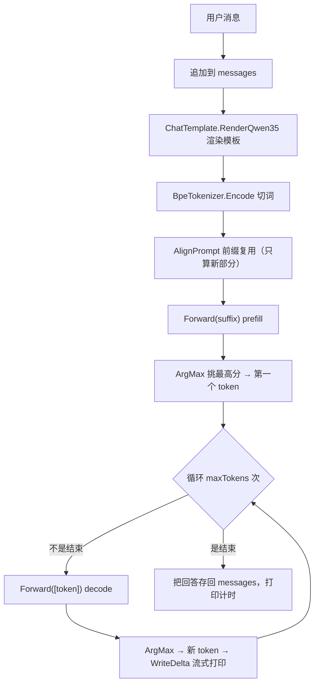

# 第 14 章 让它开口说话：CLI 与自回归生成循环

> 面向初学者：本章把前面的引擎零件装进一个能在终端对话的程序。你会看到参数解析、一次回答的完整流程、多轮缓存复用、流式输出。每小节贴 `src/Qwen35Sharp.Cli/Program.cs` 的**真实源码**。

模型层全齐了。现在把一切都装进一个程序——那个用户在终端里真正交互的东西。这一章把前 13 章的所有引擎零件第一次缝合成"能对话的成品"。

这一章的走法：我们**首先**看命令行入口与参数解析（14.1 节）；**其次**跟着 `Reply` 走完一次回答的完整旅程（14.2 节）；**接着**看前缀缓存复用怎么让多轮对话不再重复计算（14.3 节）；**然后**看流式输出、停止判定与 REPL（14.4 节）；**最后**收拢成一句话。

## 14.1 命令行入口与参数解析

`src/Qwen35Sharp.Cli/Program.cs`（top-level statements，即"顶层语句"：不用写 main 函数）开端定义 CLI 的全部输入（真实代码，带注释）：

```csharp
string modelPath = Args.Get(args, "--model")            // "--model 模型路径" 参数
    ?? @"D:\_\model\Qwen3.5-4B-Q4_K_M.gguf";            // 没传就用默认路径
string? prompt = Args.Get(args, "--prompt");            // 一次性提示词（不给就进 REPL）
string? system = Args.Get(args, "--system");            // 可选的系统消息
int maxTokens = Args.GetInt(args, "--max-tokens", 256); // 最多生成多少 token
int threads = Args.GetInt(args, "--threads", 0);        // 线程数，0 = 自动
Console.OutputEncoding = Encoding.UTF8;                 // 中文/emoji 流式输出的地基！
Console.InputEncoding = Encoding.UTF8;

Console.WriteLine($"Qwen35Sharp  model={modelPath}");
Console.WriteLine($"threads={threads}  avx2={Avx2.IsSupported}  vnni={AvxVnni.IsSupported}");

using Qwen35Model model = new(modelPath, threads);      // 打开模型（自动加载权重）
Console.WriteLine($"threads={model.ThreadCount}  arch={model.Config.Architecture} "
    + $"layers={model.Config.NumLayers} hidden={model.Config.HiddenSize} "
    + $"heads={model.Config.NumHeads}/{model.Config.NumKvHeads} vocab={model.Config.VocabSize}");
```

`Args` 解析器（同文件末尾），非常简单：

```csharp
static class Args
{
    public static string? Get(string[] args, string name)          // 取 "--name 值"
    {
        int i = Array.IndexOf(args, name);
        return i >= 0 && i + 1 < args.Length ? args[i + 1] : null;
    }
    public static int GetInt(string[] args, string name, int fallback)
        => int.TryParse(Get(args, name), out int value) ? value : fallback;  // 带默认值
}
```

## 14.2 一次回答的完整旅程：Reply

`Reply(model, messages, user, maxTokens)` 是"一次完整生成"的编排者（真实代码，带注释）。用一张图先看全貌：



代码：

```csharp
static void Reply(Qwen35Model model, List<ChatMessage> messages, string user, int maxTokens)
{
    messages.Add(new ChatMessage("user", user));                    // ① 记录用户消息
    string rendered = ChatTemplate.RenderQwen35(messages);          // ② 渲染模板
    int[] promptIds = model.Tokenizer.Encode(rendered);             // ③ 切词
    Stopwatch gen = Stopwatch.StartNew();
    PromptAlignment align = model.AlignPrompt(promptIds);           // ④ 前缀复用
    float[] logits = model.Forward(align.Suffix);                   // ⑤ prefill
    double prefillMs = gen.Elapsed.TotalMilliseconds;
    int token = ArgMax(logits);                                     // ⑥ 第一个 token
    List<int> generated = [];
    if (!model.Tokenizer.IsStop(token)) generated.Add(token);

    if (!Console.IsOutputRedirected) Console.Write("Assistant: ");
    string visible = "";
    WriteDelta(model, generated, ref visible);                      // 首段增量打印

    gen.Restart();
    int decoded = 0;
    for (int i = 0; i < maxTokens; i++)                             // ⑦ 自回归 decode 循环
    {
        if (model.Tokenizer.IsStop(token)) break;                   //    遇到结束符就停
        logits = model.Forward([token]);                            //    一次只喂 1 个 token
        token = ArgMax(logits);
        decoded++;
        if (model.Tokenizer.IsStop(token)) break;
        generated.Add(token);
        WriteDelta(model, generated, ref visible);                  //    增量流式打印
    }

    if (!Console.IsOutputRedirected) Console.WriteLine();
    double decodeMs = gen.Elapsed.TotalMilliseconds;
    string text = model.Tokenizer.DecodeVisible(generated);
    messages.Add(new ChatMessage("assistant", text));               // ⑧ 记回答（不 Trim）

    int processedPrefill = align.Suffix.Length;
    Console.WriteLine($"prefill tokens={promptIds.Length} (cached={align.Cached})  "
        + $"{prefillMs:F1} ms  {processedPrefill / (prefillMs / 1000.0):F2} tok/s  |  "
        + $"decode tokens={decoded}  {decodeMs:F1} ms  {decoded / (decodeMs / 1000.0):F2} tok/s");
}
```

## 14.3 前缀缓存复用：多轮对话不再重复计算

`model.AlignPrompt(promptIds)` 是第 10 章 `KvCacheAlign` 的模型层入口（`Qwen35Model.cs`）：

```csharp
public PromptAlignment AlignPrompt(ReadOnlySpan<int> promptIds)
{
    PromptReuse plan = KvCacheAlign.Plan(CollectionsMarshal.AsSpan(_cacheTokens), promptIds);
    TruncateCache(plan.TruncateTo);
    return new PromptAlignment(plan.TruncateTo, promptIds[plan.SuffixStart..].ToArray());
}
```

多轮收益：

```
Round 1:  system + user1                   → 整段 prefill（首次无缓存）
Round 2:  system + user1 + assistant1 + user2
           └──────────┬──────────┘           ↑ 新
           公共前缀命中缓存                   只算 user2 这一段
```

**诚实的边界**：截断只作用于全注意力 KV；线性注意力状态不回滚（第 11.7"只增不缩"）——`/reset` 用 `ResetCache` 全清，是唯一可信的线性状态清零入口。

## 14.4 流式输出、停止判定与 REPL

### WriteDelta：增量差分流式

```csharp
static void WriteDelta(Qwen35Model model, List<int> generated, ref string visible)
{
    if (Console.IsOutputRedirected) return;
    string next = model.Tokenizer.DecodeVisible(generated);        // 全部已生成 → 可见文本
    if (next.Length > visible.Length && next.StartsWith(visible, StringComparison.Ordinal))
        Console.Write(next[visible.Length..]);                     // 只打印新增部分
    else if (next != visible)
        Console.Write(next);
    visible = next;
    Console.Out.Flush();
}
```

技巧：每次**重新 decode 全部 generated** 得 `next`，只打印 `next[visible.Length..]`（"新多出来那段"）——这样即使一个中文的半个 UTF-8 字节落在某个 token 里，也不会提前输出半个乱码，可见文本永远是完整合法的字符串。

### ArgMax 与 REPL

```csharp
static int ArgMax(float[] logits)      // 贪心：挑分数最高的
{
    int best = 0; float max = logits[0];
    for (int i = 1; i < logits.Length; i++)
        if (logits[i] > max) { max = logits[i]; best = i; }
    return best;
}
```

REPL 分支（`Program.cs` 主循环）：`/reset`（清 messages + `model.ResetCache()`）、`/exit`/`/quit`（break）、`/help`、其它行 `Reply(...)`。`Console.IsInputRedirected`/`IsOutputRedirected` 切批处理模式（不打印提示符、一次输出完整文本），让 CLI"既能交互、也能脚本化"。

### 结束的输出统计

```
prefill tokens=N (cached=C)  X ms  Y tok/s  |  decode tokens=M  X ms  Y tok/s
```

`prefill tok/s` 只算未缓存部分（`align.Suffix.Length`）——"真正新算的"，缓存命中不算这轮成本。

> **一句话总结这一章**：CLI 用 `Args` 解析五参数，`Reply` 把模板渲染、编码、`AlignPrompt` 前缀复用、prefill/decode 循环、`IsStop` 停止判定、`WriteDelta` 流式串成一次完整生成；`ArgMax` 贪心。**"从零自制大模型推理引擎"的能跑版本真的完成了**——终端敲一句话，引擎流式回你一句。但对正确性成为可回归事实、对话持续变快，还需要最后两章：测试与性能。