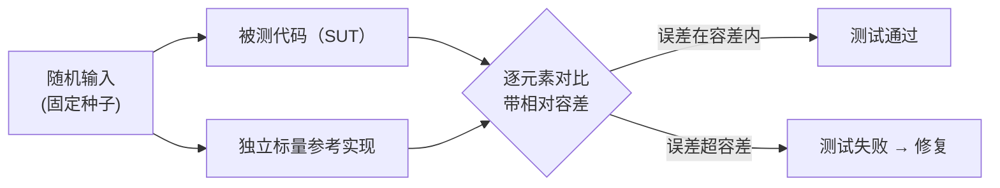

# 第 15 章 用测试锁住正确性：没有 GPU 也想对答案

> 面向初学者：本章讲"在没有教科书答案的情况下，怎么证明自己算对了"——答案是"参考对拍"。每小节贴 `tests/Qwen35Sharp.Tests/` 的**真实代码**。

一个 CPU 推理引擎最孤独的时刻，是它说"我算对了"，却没有任何第二套实现可以对照——因为**我们就是"唯一实现"**。怎么让"算得对"成为可回归的事实？答案就是反复预告的：**参考对拍**。

这一章的走法：我们**首先**立起测试哲学——对拍，而非自证（15.1 节）；**其次**看镇书之宝：Gated-DeltaNet 递推对拍（15.2 节）；**接着**看数值内核与融合路径的守恒（15.3 节）；**然后**看怎么手写二进制文件、怎么测缓存对齐与线程划分（15.4、15.5 节）；**最后**诚实地承认哪些盲区还没覆盖（15.6 节）。

## 15.1 测试哲学：对拍，而非自证



> **每个数值测试都配一个独立、可读的标量/数学参考实现。** SUT 与参考在**同一份随机输入**上各自计算，用相对容差断言一致。禁绝"用 SUT 验证 SUT"。

为什么必须是"独立实现"？因为参考和被测代码若共享同一套 bug（比如都忘了减 32），测试永远通过。配套纪律四条：

1. **确定性随机**：固定种子（1234 / 7 / 9），测试可重现。
2. **相对容差**：SIMD 与标量求和次序不同，尾差必然存在；用容差区分"数值一致"与"浮点噪声"。
3. **输入预处理**：随机量化块先 `ForceValidScales` 修 fp16 尺度，避免随机 NaN/Inf 干扰断言。
4. **刻意依赖 AVX2+FMA**：数值断言明确要求 `Avx2.IsSupported && Fma.IsSupported`，否则跳过——保证断言真打在 SIMD 路径上。

`tests/Qwen35Sharp.Tests/IQ4XSTests.cs` 里的 `ForceValidScales` 就是纪律 3 的体现：

```csharp
[Fact]
public unsafe void DequantizeRow_MatchesReference()
{
    // 随机字节 → 排成 IQ4_XS 块 → ForceValidScales(raw, nb) 让 fp16 网格尺度 = 1.0f
    // → IQ4XS.DequantizeRow vs 按 llama.cpp 公式手写的参考，逐元素 <1e-4
}
```

## 15.2 镇书之宝：Gated-DeltaNet 递推对拍

`tests/Qwen35Sharp.Tests/GatedDeltaNetOpsTests.cs` 的 `RecurrentGatedDeltaRule_MatchesReference` 是全书最重要的测试。它是"独立参考实现 + 对拍断言"的完全样本（真实代码，带注释）：

```csharp
[Fact]
public unsafe void RecurrentGatedDeltaRule_MatchesReference()
{
    const int tokens = 5, nHeads = 2, headDim = 4, vHeadDim = 4;   // 小尺寸，每元素可追溯
    const float eps = 1e-6f;
    Random rng = new(1234);                          // 固定种子，可重现

    // 随机输入（g 要 ≤ 0，β 落在 [0,0.5]）
    for (int i = 0; i < g.Length; i++)
        g[i] = -(float)Math.Abs(rng.NextDouble()) - 0.01f;    // g <= 0
    for (int i = 0; i < beta.Length; i++)
        beta[i] = (float)(0.5 * rng.NextDouble());

    // ---- 独立参考（l2normQk=true 是 Qwen3.5 的案例）----
    // 用最直白的三重循环按 delta rule 手写一遍，与 DeltaStep 数学一致、代码路径独立；
    // 包括 L2 归一化、衰减、读 kvMem、δ 更新、读 out。
    // ...

    // ---- SUT ----
    fixed (float* qP = q, kP = k, vP = v, gP = g, betaP = beta, sP = stateCopy, oP = gotOut)
    {
        GatedDeltaNetOps.RecurrentGatedDeltaRule(
            qP, kP, vP, gP, betaP, sP,
            tokens, nHeads, headDim, vHeadDim, eps, oP, l2normQk: true);
    }

    // ---- 对拍断言（容差 1e-3），状态 S 与输出 out 都校验 ----
    for (int i = 0; i < refOut.Length; i++)
        Assert.True(Math.Abs(refOut[i] - gotOut[i]) < 1e-3, $"out[{i}]: ref={refOut[i]} got={gotOut[i]}");
    for (int i = 0; i < refState.Length; i++)
        Assert.True(Math.Abs(refState[i] - stateCopy[i]) < 1e-3, $"state[{i}]: ...");
}
```

测试文件还用 `qkIndex`/`vIndex`/`sIndex` 辅助把多维索引展平成线性，保证参考实现可读：

```csharp
// Layout helpers match GatedDeltaNetOps.RecurrentGatedDeltaRule:
//   q/k [token, head, headDim]; v [token, head, vHeadDim]
//   g/beta [token, head]; state [head, headDim, vHeadDim]
private static int qkIndex(int t, int h, int nHeads, int headDim) => (t * nHeads + h) * headDim;
private static int vIndex(int t, int h, int nHeads, int vHeadDim) => (t * nHeads + h) * vHeadDim;
private static int sIndex(int h, int a, int b, int headDim, int vHeadDim) => h * headDim * vHeadDim + a * vHeadDim + b;
```

**为什么它是全项目命门**：线性注意力是 Qwen3.5 的标识，它错了，整本书的"混合架构"名号就是空话。任何未来重构（向量化三 pass、就地归一、chunk 复现）都必须**先**让这个测试继续通过。

## 15.3 数值内核与融合路径的守恒

`tests/Qwen35Sharp.Tests/FastExpTests.cs` 一群数值断言：

- `ExpAvx2_TracksMathF`：`FastExp.ExpAvx2` 与 `MathF.Exp` 相对误差 < 2e-5。
- `SiLUMul_TracksScalar`：`Ops.SiLUMulRange` 与标量 `x/(1+e^-x)·up` 相对误差 < 2e-4。
- `Quantize4x8Silu_MatchesSiLUThenQuantize`：融合版与"先 SiLU 再 Quantize4x8"逐字节一致。
- `ThreadPool_ForSplitsWork`：`CpuThreadPool.For(32, body)` 覆盖 [0,32) 每项一次。

`IQ4XSTests` 还有 `Dot_MatchesScalarDequant`：`IQ4XS.Dot` vs "反量化后做点积"的参考，容差 1e-2 / 1e-4·|ref|。

**融合路径逐位守恒是硬要求**：`Quantize4x8Silu` 是优化，绝不能引入语义偏差——量化是确定性的，所以融合版与朴素版应算出一模一样的字节。

## 15.4 手写二进制文件：不依赖真权重的格式测试

`tests/Qwen35Sharp.Tests/GgufTypeTests.cs` 的 `LegacyStride16Type42IsNormalizedWithoutBreakingQ2` 用手写最小 GGUF 测 type 42 消歧：

```csharp
[Fact]
public void LegacyStride16Type42IsNormalizedWithoutBreakingQ2()
{
    // 用 BinaryWriter 手写最小 GGUF：
    //   含 "Stride16" 名称 + file_type 41 + raw type 42 → 规范化成 STQ1_0
    //   普通 Q2_0 文件（无这些特征）→ 保持 Q2_0
    // 两条分支各测一遍，互不误读
}
```

副产品：**仓库完全不含 GGUF 二进制，克隆就能测**（K 系块、BPE 都用合成数据）。

## 15.5 缓存对齐与线程划分的专项测试

`tests/Qwen35Sharp.Tests/KvCacheAlignTests.cs` 五条用例：

```csharp
[Fact] public void DivergingTail_KeepsSharedPrefix()        // 分歧 tail 截断到3，suffix=[6,7]
[Fact] public void LongerCacheThanPrompt_DoesNotDropPrefix() // 缓存长于提示不丢前缀
[Fact] public void FullHit_ReplaysLastToken()               // 全命中截断到 len-1
[Fact] public void EmptyCache_ForwardsWholePrompt()         // 空缓存整段
[Fact] public void NoOverlap_Resets()                       // 无重叠全部重置
```

每个 `KvCacheAlign.Plan` 分支都有对应用例——"能不能删掉一个 if 而保住正确"的试金石。

## 15.6 覆盖盲区：诚实地承认没测什么

`doc/10-testing.md` §10.4 明确列出的盲区：

1. **无端到端生成测试**——需要真实权重，仓库未包含；整条链正确性目前由各层单测接力保证。
2. **MoE、STQ1_0、Q2_0C、Q5_K、Q6_K 的 panel 与 GEMV 尚无专项对拍**——但 `DotScalarForTest`/`DotScalar` 参考锚点已在，补齐只是时间问题。
3. **分词器（BPE）与聊天模板没有专项单测**——只靠 CLI 间接行为验证。

三个盲区的价值不在"羞愧"，而在"路线图"：每个盲区自带补法（把参考锚点连成对拍、加一个小 GGUF 做端到端冒烟……）。

> **一句话总结这一章**：对拍哲学（独立参考 + 固定种子 + 相对容差 + 刻意依赖 SIMD）把"算得对"变成可回归事实；`GatedDeltaNetOpsTests` 是压舱石，FastExp/IQ4XS 数值测试与 `Quantize4x8Silu` 融合守恒守住"优化不改数学"，`GgufTypeTests` 手写文件测格式，`KvCacheAlignTests` 守护多轮对话。但"算得对"与"跑得快"之间隔着一座山——第 16 章，我们学习看见时间都去哪了。